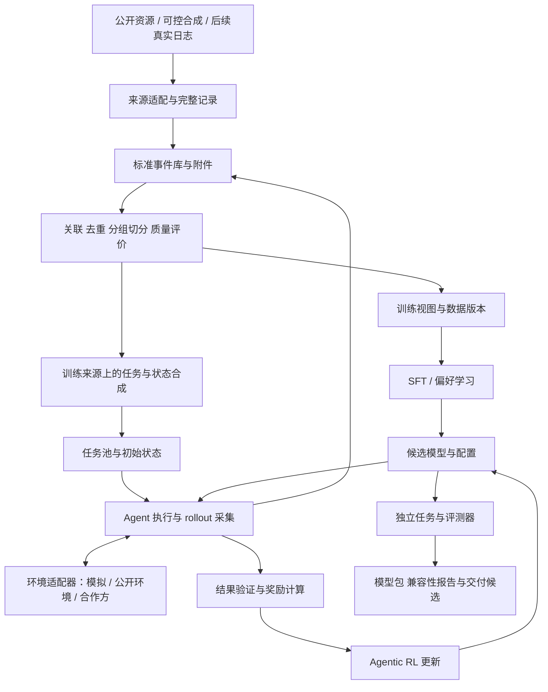

# 记忆使用的数据工作：入门流程与具体例子

2026-11-03 更新。当前分工：我们负责数据筛选、合成、数据侧评估与交付，训练基础设施和训练算法由其他同事配合。项目当前背景与调整记录见 [项目说明](README.md)。

**1. 先用一句话定义我们在做什么**

把“什么记忆＋什么情境下，agent 应怎样提供服务”写成有依据的样例；筛出可靠示范，补齐缺少的情况，再用独立题目检查能力是否增强。

本轮先给定候选记忆，检查模型是否用对；取得真实系统接口后，再检查相关记忆能否被找出。不要把检索失败、记忆库缺失和看到后理解错误混为一类。当前不建设新的记忆存储／检索系统，也不先实现训练基础设施。

**2. 用一个完整例子理解一条数据**

下面全部是虚构情境，用于解释数据格式与规则，没有真实用户或 agent 执行结果。

当前情境：周二 23:00，agent 正在准备次日的阅读推荐。可用材料包括一篇用户尚未读过的 AI 研究文章及其准确的五分钟摘要。

| ID | 当时可用的记忆 | 如何理解 |
| --- | --- | --- |
| M1 | 用户长期关注 AI 研究，喜欢深入阅读 | 相关兴趣与一般偏好 |
| M2 | 用户明确表示：近期工作日时间紧，先给五分钟摘要，需要时再读全文 | 针对近期工作日的具体要求；没有否定所有深度阅读偏好 |
| M3 | 用户明确表示：22:00—08:00 不要推送阅读推荐 | 交付时间约束 |

一种可接受表现：准备准确的短摘要并附全文入口；夜间不立即推送，按允许时段安排交付。评价允许其他同样符合条件的方案，不要求逐字复现一个标准答案。

可排除的表现：只根据 M1 推荐长篇全文并马上推送；把“工作日先看摘要”理解成“用户不喜欢深入研究”；声称用户已阅读某文但没有对应记录。

数据侧标注应指出支持判断的 M1／M2／M3 和行为约束。这是可核验的依据，不是补写模型的隐藏推理。是否真的完成排程或推送，需要对应运行证据；仅生成“我已安排”的文字不能算执行成功。

**3. 筛选：逐条判断候选表现是否可用**

可以先对上面的案例生成若干候选，也可以日后导入真实轨迹。来源不同，验证方式和可支持的结论也不同。

| 检查 | 人工能回答的简单问题 | 可程序化的部分 |
| --- | --- | --- |
| 信息完整 | 是否知道当时的情境、时间及模型实际可见记忆 | 必要字段、缺失原因、附件引用 |
| 依据正确 | 引用的是相关记忆吗，是否凭空增加用户事实 | 记忆 ID 是否存在、来源是否可查；语义仍需核验 |
| 含义正确 | 是否理解工作日、近期、未完成等条件 | 可明确编码的时间与状态规则 |
| 行为匹配 | 内容形式、交付时间和动作是否符合依据 | 明确的结果约束；开放表达由人工／模型辅助检查 |
| 可追溯 | 谁生成、用什么输入、为什么留下或排除 | 来源、父案例、版本、审核状态 |

先保留“可用示范／不合格候选／待复核”三类判断，并写具体原因；它们不是完整业务真值。待复核不能自动算失败，也不能混进正面示范。

最初人工逐条核验，用来建立标准；规则自动检查确定性的事项，模型辅助做语义初审。标准成熟后再讨论抽检与扩大处理量，避免一开始依赖模型自己给自己打高分。

**4. 合成：在可解释的变化下补齐缺少的情况**

围绕这个案例，可以制作以下变体。先确定情境中什么改变了、什么仍保持不变，再生成候选。变体是虚构测试条件，不能伪装成真实用户历史。

| 改变什么 | 预期检查什么 | 需要避免的错误 |
| --- | --- | --- |
| 加入“已在白天交付过该摘要”的可信记录 | 是否避免无必要的重复推荐 | 仍沿用原答案，重复推送 |
| 将明确的当前阅读要求改为“这次需要全文” | 是否结合具体要求调整内容形式 | 一直使用旧摘要偏好，或忽略仍有效的交付时间限制 |
| 移除 M2 及 M1 中“喜欢深入阅读”，保留 AI 兴趣与推送时间约束 | 是否承认内容长度的个性化依据不足，允许中性选择、等待或适当澄清 | 凭空断言用户只喜欢短文；也不能规定所有无记忆情况都必须沉默 |
| 加入一条无关的音乐喜好 | 内容决策是否保持合理稳定 | 为了表现“用了记忆”而强行改变推荐 |
| 加入与 M2 含义相近但措辞不同的记忆 | 是否依照语义判断，而不是匹配固定词句 | 把改写当成不同用户需求 |

同一原始故事及其这些变体属于一个来源家族，不能把一部分用于训练、另一部分当独立测试。独立评测应另用故事、历史和任务组合；最终测试样例不用于生成训练变体。

先从一类变体做起，例如已交付／未交付。批量生成前确认判断标准能区分正确与错误，再逐步增加变化组合。数量由覆盖和误差情况决定，不把堆积改写文本当作能力增强。

**5. 一个样例可以导出哪些交付**

| 产物 | 保留什么 | 给谁使用 |
| --- | --- | --- |
| 评测样例 | 输入记忆、情境、允许／不允许行为和检查证据 | 双方用于开发诊断或独立阶段评测，明确各自切分 |
| SFT 示范 | 相同输入，加经核验的正确动作或回复 | 训练同事按实际模型格式进行训练 |
| RL 候选任务规格 | 输入和初始状态、行动目标、结果检查条件、未知依赖 | 训练同事接入实际采样环境与奖励；未接入前不称为可运行 RL 任务 |
| 数据质量报告 | 来源、覆盖、排除理由、待复核内容、版本与已知限制 | 双方决定是否扩大和怎样补缺 |

训练输出 token 的掩码、工具格式等具体协议由双方对齐；数据中保留角色、动作和环境响应的区别，避免后续无法正确转换。没有真实执行的候选动作，不作为已经验证成功的工具轨迹。

最早可以先交付评测样例与 SFT 示范。RL 规格随同事接口条件推进，偏好数据在有明确需求与可比候选时再补。

**6. 怎样知道数据工作有帮助**

先检查数据本身：一条样例是否有依据、规则是否一致、来源是否可追溯、各类记忆问题是否有覆盖。引用记忆正确但行为错误仍应判为错误。

能够调用目标 agent 或取得同事输出后，再比较：相关记忆是否被正确选择；含义、时效与冲突是否处理正确；输出行为是否符合；缺少证据时是否避免虚构偏好。对关键记忆和无关记忆做有控制的变化，可以帮助发现模型是否只是表面引用，但不能仅凭一次变化就声称证明了完整因果关系。

分别评估“给定相关记忆的使用”和“实际记忆系统接入后的整链路表现”。如后者更差，可检查原记忆是否存在、检索是否返回、模型是否看到、看到后怎样使用；日志缺失时原因标未知。

训练同事在相同评测条件下提供训练前后结果，我们按错误类型分析哪些数据有效、哪些仍缺。留出评测里有改进才支持相应能力判断；真实用户是否更满意还需要实际服务反馈。

**7. 第一阶段做哪些具体工作**

1. 写一张小样例表，涵盖正常偏好使用、条件适用、已有交付、缺少依据和无关干扰，并逐条写判定理由。起步可先写约 20 条，便于人工逐条检查；这是可调整的试做规模，不是充分覆盖或效果验证的门槛。这张表先用来把标准对齐。
2. 保存为简单 JSONL，做字段、引用、来源和切分检查；保留人工可读的表格视图。每条都有输入、候选、依据和审核状态。
3. 对一个受控变体生成候选，经人工／规则／模型辅助核验后分流；查看筛选理由是否清楚且一致。
4. 打包一版评测／示范数据交给训练同事试接，取得输出后再分析错误与扩充。没有目标 agent 输出时，只报告数据规范与验证完成，不报告能力提升。

初期工具就是表格、JSONL 和 Python。自动生成或模型初审可在调用条件具备后加入；现阶段不引入新的训练器、复杂向量选数系统或大规模环境平台。

这几项是待讨论的实施顺序。当前实际完成的是方案、示例说明和文档调整，尚未开展批量合成、筛选或模型评测。

**8. 旧方案怎样处理**

前版的数据来源追溯、独立切分、完整记录和证据验证原则继续使用。训练基础设施、训练算法与大环境建设已移出当前本方起步计划；公开记忆／主动服务研究在遇到具体问题时再定向使用。旧材料保留，是为了回查依据，不代表当前都要实施。

前版参考：全流程架构与技术比较（当前执行范围以本文及项目说明为准）

# 主动服务 agent：整体架构、技术比较与推进方案

研究与设计草案，2026-11-03（Asia/Shanghai）。依据本仓库 research skill，结合用户已提供的背景，以及本轮查阅的论文、官方文档和部分仓库文件。当前没有合作方代码、真实数据、模型接口或算力配置；本轮完成方案与资料核验，没有安装候选框架、运行实验或验证业务收益。

项目目标、合作边界和讨论变化以 [项目说明](README.md) 为入口。本文件独立维护架构、模块选择和验证路线，后续直接更新，不按每轮讨论复制新版本。技术推荐属于待讨论建议，不表示已经决定实施。

**1. 当前条件下怎样推进**

建议先构建可以替换数据源、环境和训练后端的研究流程：用公开资源与明确标为合成的可控场景检验接口和方法，取得合作方接口后再迁移。近期应得到可运行、可诊断的训练评测样机；实际主动服务能力是否提升，最终需要在合作方系统和相应任务上验证。

“最优”需要对应目标与约束：最快取得基线、最低运行成本、最高能力上限、最小接入改动、最稳定运行，可能需要不同方案。本文对易用性和工程成本的比较是基于接口与依赖的判断，并非本项目实测排名；“通用／常见”指成熟技术路径，不代表市场占有率排序。

先保留三个有实质差异的训练对象：

| 研究对象 | 方法选择 | 适用条件 | 代价与关键未知 |
| --- | --- | --- | --- |
| 主动服务决策，例如是否行动、何时交付、选哪个 skill | 规则基线、监督分类／排序、小模型或 LLM SFT、contextual bandit（上下文决策） | 决策接口可接入，候选动作可明确，执行能力已较完整 | 接入可能较轻；局部决策收益不能代表长程任务最优 |
| 实际执行策略，例如工具选择、参数、恢复与验证 | 多轮 SFT、偏好学习、执行环境中的 RL | 模型可训练或替换，有轨迹和执行／奖励接口 | 需要处理长上下文、环境反馈、稀疏奖励与训练推理一致性 |
| 主动决策与执行的联合策略 | 分层策略、阶段奖励、长程 RL、记忆条件化训练 | 能关联上下文、执行和后续反馈，且各部分可控 | 研究价值高，但归因、状态覆盖和调试更难；不能先假设必须拆成多个模型 |

工程上先让前两类能够分别评估，再依据错误分布决定是否联合训练。合作方本体改造不自动纳入我们的开发范围。若暂时只有封闭模型调用权限，可先研究数据、评价器、可替换决策模块或开源替代模型；不能据此声称已经微调了合作方模型。

**2. 整体架构：共享数据与评测，连接离线学习和在线采样**

图中的合成任务进入真实执行或受控模拟执行后，轨迹仍需回到质量评价环节，才可进入 SFT 数据。RL 使用任务、初始状态与当前策略新采样的过程；不能把任意历史成功 trace 直接当作当前策略的 on-policy rollout。

开发集用于选策略、调参数和校准评价器；最终测试集及其派生内容不进入生成、检索、选数或训练。评测与训练可以共享底层记录协议和环境适配器，但不共享需要隔离的任务、标签或测试答案。

贯穿整个流程的公共能力是：版本清单、来源关联、完整失败记录、成本统计和运行恢复。初期可由一组本地 Python 模块组成；没有必要先拆为微服务。

**3. 来源适配、标准数据与最小接口**

| 模块／接口 | 接收与产出 | 初期实现建议 | 扩展条件 |
| --- | --- | --- | --- |
| 来源适配器 | 原始日志／公开数据 → 标准事件＋原始引用 | Python 解析器＋Pydantic／JSON Schema；格式各自适配 | 多来源增多时维护转换版本与兼容性用例 |
| TaskSpec | 决策时可见上下文、初始状态、可用工具、任务族、有效时间与成功条件 | YAML／JSON；区分 agent 可见信息和评测侧真值 | 可生成任务与状态组合，引用附件和环境快照 |
| AgentRunner | 任务、模型端点、配置 → 实际请求响应与执行记录 | 先接公开 agent 或最小工具调用循环 | 后续接合作方进程／服务，保留其真实 skill 和上下文管理 |
| EnvironmentAdapter | reset／step／observe／时间推进；可选 snapshot／restore | 与 Gymnasium 风格类似的窄接口，不要求依赖特定库 | 不支持快照时明确能力缺失，不伪造可回放性 |
| Verifier | 任务、轨迹、产物、状态 → 分维度判断、证据、未知项 | 确定性检查＋结构化评价 | 奖励映射单独配置，避免把报告分数直接硬编码为唯一奖励 |
| DatasetBuilder / TrainerAdapter | 固定数据清单 → SFT／偏好样本或 RL 任务；训练 → 模型与日志 | 训练格式在出口转换，保留领域表示 | 更换训练器时不用重做所有数据清洗逻辑 |

TaskSpec 中的真实隐藏需求可以供模拟器或评测器使用，但 agent 只能看到决策时实际可获得的证据。显式指令执行和隐含需求发现应能分别表示，不能把正确答案写进训练时的任务提示，造成能力虚高。

采集方式有三个选择：文件导入最易启动；模型代理便于接现有 agent 并取得训练用 token 信息；运行时 hook 能补充触发、记忆、工具和交付事件。代理只能看到经过代理的信息，不能代替完整系统日志。实际组合取决于合作方开放的接口。

事件记录建议关联 opportunity/task/run/step ID、父子调用、时间、输入可见范围、模型和 skill 版本、工具 schema、工具请求响应、状态变化、终止原因、产物与反馈。未来 RL 采样需额外关注真实 token IDs、行为策略版本、采样参数、log probabilities、loss mask 和多模态预处理；历史日志缺失这些字段时明确用途边界，不补造。

普通对话文本往往无法还原上下文裁剪、摘要和记忆检索后的真实模型输入。应保留实际请求；摘要可以是派生视图，不能取代原记录。环境报错、用户拒绝、超时、模型终止和记录缺失分别编码。

观测链路可映射到 OpenTelemetry 的 agent spans，便于关联调用，但当前 GenAI 语义约定仍标为 Development，需要锁定版本并保留自身数据 schema。依据：[官方 agent span 约定](https://github.com/open-telemetry/semantic-conventions-genai/blob/main/docs/gen-ai/gen-ai-agent-spans.md)。

**4. 环境与公开资源：选择接近研究问题的替代环境**

| 方案 | 最适合验证什么 | 易用性／真实性取舍 | 本项目建议 |
| --- | --- | --- | --- |
| 固定日志和状态快照回放 | 解析、上下文构造、离线打分、SFT 导出 | 简单、可重复；换动作后没有真实的反事实后继状态 | 数据与接口基线，不能当作完整交互 RL 环境 |
| 小型确定性状态机＋虚拟时钟 | 行动／等待、状态更新、重复交付、失效内容和恢复流程 | 易检查、易重置；行为与用户分布较简化 | 作为接口用例与难点隔离环境；用来证明流程行为，不证明业务价值 |
| PARE | 主动观察、目标推断、介入时机与跨应用操作 | 与本项目较贴近；依赖模拟用户、模型调用和既定动作空间 | 首个完整公开环境候选，先核验安装、可控重置、轨迹与评价接口 |
| AppWorld / τ²-bench | 多应用工具执行、状态一致性、用户与 agent 协作 | 程序化评价较有价值；原始任务不等于本项目主动场景 | 按需要补执行能力对照；主动场景改造需另定义触发和真值 |
| AndroidWorld | Android GUI 感知与实际交互 | 模拟器和视觉动作成本更高；未必匹配 API／skill 型执行 | 只有确认 GUI 能力是目标后优先接入 |
| 合作方真实运行环境 | 真实上下文、skill 行为和部署兼容性 | 最接近目标，但重置、账号状态和反馈接入未知 | 后续迁移依据，适配器预留接口，不提前重建 |

PARE 原论文以状态机建模应用；其官方 README 明确用户模拟器按屏幕导航，而主动 agent 可通过扁平 API 操作应用。这一不对称设计有利于研究主动服务，但不等同真实手机 GUI 权限与操作成本。依据：[PARE 论文，2026-04](https://arxiv.org/abs/2604.00842)、[官方实现说明](https://github.com/deepakn97/pare)。

其他资源依据：[AppWorld](https://aclanthology.org/2024.acl-long.850/)、[τ²-bench](https://arxiv.org/abs/2506.07982)、[AndroidWorld](https://google-research.github.io/android_world/)。它们提供不同执行与评价结构，不应直接合并成一个代表业务能力的总榜单。

夜间任务建议用虚拟时钟表达“准备时间—允许交付窗口—内容过期—后续反馈”，避免实验真的等待一整夜。同组对照固定初始条件与外部事件计划，允许不同 agent 动作产生不同后续状态；只固定随机种子不能保证交互轨迹完全可比。

**5. 数据存储、清洗、切分与筛选**

推荐基础组合为 JSONL 原始事件＋附件文件／对象引用＋Parquet 标准数据＋DuckDB 查询。Pydantic 校验结构；配置和 manifest 记录处理版本、来源哈希、模型／提示词版本、切分与统计分母。DuckDB 可直接读写 Parquet，适合先做本地分析：[官方文档](https://duckdb.org/docs/stable/data/parquet/overview)。这些是初期技术建议，数据体量和协作需求明确后再决定存储服务。

| 技术 | 工作机制 | 方便／稳定之处 | 局限与升级条件 |
| --- | --- | --- | --- |
| 规则检查＋状态证据 | 验证 schema、调用关联、动作前置条件和结果 | 透明、可定位，适合首个可重跑基线 | 规则可能误删有效轨迹或漏掉语义问题，需抽查校准 |
| 哈希／MinHash 去重 | 找到精确或词面近重复 | 成本低，可批处理 | 不识别全部语义重复；不能删除研究中的真实重复运行统计 |
| embedding 聚类＋分层采样 | 按语义和任务覆盖选择样本 | 有助控制单一任务或用户来源占比 | 相似度不是质量或训练价值；阈值需要校准 |
| LLM／VLM 评价 | 根据任务、证据、轨迹按 rubric 输出结构化判断 | 易扩展语义检查，能处理多种错误类型 | 有位置、文风和自偏好；需要未知／弃权和人工或环境证据复核 |
| LESS 等梯度／影响选数 | 用目标能力开发集与候选数据的梯度特征估计帮助程度 | 比纯语义相似更直接联系学习目标 | 需要模型访问与特征计算；长轨迹、多模态和主动服务迁移待验证 |
| 基于训练反馈的动态采样 | 用学习进展、错误簇、模型分歧更新数据配比 | 能对准当前模型短板 | 多轮训练与评测成本高，容易过拟合开发集 |

Data-Juicer 可复用清洗、MinHash 和 embedding 算子；本轮检查到其部分 agent 相关算子仍标 Alpha／Beta，不能将框架可用等同于任务质量判断可靠。[算子目录](https://github.com/datajuicer/data-juicer/blob/main/docs/Operators.md)。

梯度选数依据：[LESS，ICML 2024](https://proceedings.mlr.press/v235/xia24c.html)。近期系统比较强调没有单一选数方法始终占优，低选数预算下的优势也可能随预算扩大减弱：[A Critical Look at Targeted Instruction Selection，ICML 2026](https://arxiv.org/abs/2602.14696)。因此必须保留随机／分层采样和等预算对照。

建议顺序是完整性与可用性检查 → 来源家族和近重复关联 → 按声明的泛化目标切分 → 分维度评价 → 质量与覆盖联合采样。不要将所有信息压成未经校准的总分。原始记录保持完整，训练排除仅影响派生视图。

同任务变体、同前缀分叉、同一用户记忆来源和合成后代均需检查切分关联。对“同一用户未来时段”与“新用户”分别设计切分；不能简单地把同用户所有数据永远捆在一起，也不能允许未来记忆泄漏到过去决策。

失败轨迹分流：经验证的正确片段可用于相应监督；完整失败可用于错误分析、评价器或可比偏好构造。不能把失败过程全部作为正面示范，也不能默认全部丢弃。

**6. 数据合成：优先生成可执行、可验证的学习机会**

| 方案 | 产生什么 | 实现与价值 | 必须验证什么 |
| --- | --- | --- | --- |
| 模板／程序化状态变体 | 参数、时间、库存／任务状态、用户明确偏好变化 | 最容易检查和复现，适合首批场景 | 前置条件、任务可解性、真值与 agent 可见信息隔离 |
| Self-Instruct／Evol-Instruct 风格改写 | 目标表达、约束与组合难度变化 | 生成方便，能扩大表达覆盖 | 不保证可执行，且大量改写可能只是近重复；需环境验证 |
| teacher rollout＋结果验证＋选择 | 强模型在环境中实际执行的示范 | 更直接取得工具与恢复轨迹 | 保存全部尝试和成本，验证真实状态；不能只信 teacher 自评 |
| 从共同前缀分叉／失败恢复 | 可比候选、修复轨迹与偏好对 | 对恢复和关键决策有针对性 | 必须恢复可比环境和用户上下文；缺快照时只能提出候选，不能声称反事实已验证 |
| 组合子任务、状态与验证器 | 更长任务与可控复杂度 | 可研究课程学习和任务覆盖 | 组合不能引入矛盾目标或把答案泄漏给执行者 |
| 用户模拟／世界模型／自博弈 | 时机、反馈与稀缺状态 | 可探索长期互动，是重要预研方向 | 模拟偏差及奖励投机；模型生成的点击／接受不是用户真实价值证据 |

语言侧生成可参考 [Self-Instruct](https://arxiv.org/abs/2212.10560) 和 [WizardLM／Evol-Instruct](https://arxiv.org/abs/2304.12244)，重点借鉴指令生成与复杂度变化，不把指令质量等同于 agent 轨迹有效性。可借鉴 AgentSynth 的组合任务生成思想，但其原始实现面向 OSWorld／网页环境，并非手机主动服务现成数据生产线：[论文，ICLR 2026](https://arxiv.org/abs/2506.14205)、[对应作者仓库](https://github.com/sunblaze-ucb/AgentSynth)。实现来源以论文链接为准，避免混用同名项目。

建议首批自定义场景覆盖三个差异明显的例子，均为接口与研究用合成案例，不代表真实用户需求：内容已过期时不推送；已有明确需求但当前不适合打扰时先准备后交付；工具失败后恢复并验证产物。每个案例都需要正常、无需行动、证据不足和异常条件的变体。

合成应以训练来源与能力缺口为输入；先锁定测试来源，再生成其余数据。新样本继承父来源和切分，重新检查跨集合重复。标签记录生成器、提示词、输入上下文、执行记录和验证依据。用相同预算比较真实／公开训练数据、筛选后数据以及加入不同合成数据的效果，而不是只比较合成数量。

**7. 结果验证、奖励与独立评测**

| 评价方式 | 适合评价什么 | 主要优势 | 主要限制 |
| --- | --- | --- | --- |
| 程序断言／数据库状态／产物检查 | 动作是否生效、目标状态和结果约束 | 可重复、证据直接 | 规则覆盖不足也会误判；开放任务不一定有单一正确答案 |
| 明确 rubric 的 LLM／VLM judge | 需求依据、相关性、内容证据、时机解释 | 通用、扩展方便 | 需校准；不能用模型赞同替代真实执行 |
| 人工校准子集 | 验证器错误类型与真实任务判断 | 可发现系统性误判 | 有成本和分歧；当前不能假设已有业务标注人员 |
| 学习到的 reward model／过程评价器 | 扩大评价规模、给关键步骤提供反馈 | 低推理成本或更细反馈 | 继承标签偏差，训练分布外和被优化后的可靠性待检验 |
| 用户反馈与偏好 | 真实接受、纠正、拒绝和后续价值 | 更接近服务目标 | 延迟、曝光偏差、缺失和混杂；未反馈不等于失败 |

初期建议返回评价向量及证据：需求有据、任务完成、内容正确与新鲜、时机合适、重复／打扰、资源成本。硬性约束、适用条件和未知分别表达；在明确目标之后再讨论如何转换为训练奖励。格式正确仅是基础可用性，不应让模型靠格式分取得主要奖励。

AgentRewardBench 显示 LLM judge 和规则评价各有局限，支持“验证器本身也要验证”的设计：[原论文](https://arxiv.org/abs/2504.08942)。本项目应检查错误保留、有效样本误删、judge 对无关文字的敏感性及跨评价器一致性。

主动服务评测至少分别覆盖：应行动时能否帮助、不应行动时是否克制、证据不够时是否合理等待或澄清、时机窗口是否正确、执行／恢复是否成功。分别报告有服务机会和无机会场景，避免“始终沉默”或“始终主动”利用类别不平衡取得虚高总分。

开发中的 reward 与最终评价避免完全依赖同一可被策略反复优化的 judge。保留独立结果验证、独立任务与适当人工复核；明确每种证据能支持的结论。随机任务按任务族重复和分析分布，不把同题多次尝试当成更多独立任务。

针对单次交付选择，可考虑 contextual bandit 及 IPS／Doubly Robust 离线评价。但需要可识别的行为策略选择概率、足够动作覆盖及相应假设；只有被推送内容的反馈时，不能恢复未推送内容的真实价值。长期反馈会改变未来状态时，应进一步研究序列决策，而不强行简化为 bandit。参考：[Vowpal Wabbit contextual bandit 教程](https://vowpalwabbit.org/tutorials/contextual_bandits.html)、[Doubly Robust Policy Evaluation and Learning](https://arxiv.org/abs/1103.4601)。

**8. SFT、偏好学习与模型训练方式**

| 技术 | 适用场景 | 方便／稳定实现的考虑 | 不应据此推断 |
| --- | --- | --- | --- |
| 规则／分类或排序模型 | 候选行动有限，主要错误在触发／排序 | 可解释基线；训练和部署成本通常较低 | 不能覆盖复杂工具执行或长期影响 |
| SFT＋LoRA | 有较可靠示范，先检验数据是否有效 | 参数开销较小，易做对照和回退 | 不能假设与全参微调效果相同 |
| SFT＋QLoRA | 显存紧张，需要低成本方法验证 | 进一步降低权重存储需求 | 量化与硬件依赖需核验，不能默认速度更快 |
| 全参 SFT | 数据和资源充足，需要比较能力上限 | 可调整全部参数，方法直接 | 成本更高，也需要检查遗忘；不保证总比 LoRA 优 |
| DPO／偏好优化 | 同上下文有可靠好坏候选，在线环境不足 | 可以离线学习偏好，无需每个训练 step 重新运行环境 | 不能代替新策略交互；错误偏好会被强化 |

建议首个训练后端采用 TRL＋PEFT：官方 SFTTrainer 支持 assistant-only loss 与适配器训练；DPOTrainer 支持工具调用数据。[SFT 文档](https://huggingface.co/docs/trl/sft_trainer)、[DPO 文档](https://huggingface.co/docs/trl/dpo_trainer)。已有团队工具链成熟时，应优先复用而不是重复迁移。

实现时要验证实际 loss mask 和 chat template：工具返回、用户消息、系统消息及仅供评测的状态不应无区别地成为策略的预测目标。样本过长时，用有完整上下文依据的步骤样本或保留因果关系的片段；原始记录不截断，不能静默裁掉决定任务成败的后半段。多模态还要核对图片预处理和 token 对齐。

偏好样本优先使用相同决策上下文的候选动作／回复。整轨迹 DPO 涉及不同后续工具观测时，必须核验条件与被优化 token 的语义，不能直接把环境差异当作策略偏好。初期更容易检查的是共同前缀下的决策偏好。

学生模型建议先按可训练、工具调用支持、上下文长度、语言和部署要求选择一个资源可承受的开源指令模型；只有确实需要截图观测时再选 VLM。teacher／judge 可以与学生不同，但强模型参与不等于标签正确。现在不固定具体模型、参数规模或 GPU 数量。

**9. Agentic RL 算法：基线、稳定性与长程信用分配分别比较**

| 算法／路线 | 机制与价值 | 成本／依赖 | 本项目优先级建议 |
| --- | --- | --- | --- |
| GRPO | 同一任务／初始条件采样多条轨迹，利用组内相对结果更新策略，不额外训练 critic | 多次 rollout 有成本；全组同分时缺少有效区分信号，长程归因较粗 | 有可执行环境和可信奖励后的首个 RL 基线 |
| PPO＋value model | 学习状态价值，利用优势估计处理序列决策 | 额外价值模型与训练稳定性调试 | 作为需要价值估计时的对照，不因较传统而排除 |
| GSPO／SAPO | 分别从序列级重要性比率、平滑自适应门控等角度处理更新稳定性 | 需要与采样、mask、模型和训练器兼容 | 若出现长输出、MoE 或分布偏移问题，再与基线比较 |
| GiGPO | 同一组轨迹内寻找重复状态，增加步骤层面的相对优势 | 依赖可比较状态；个性化记忆可能使相同表面观测代表不同状态 | 长程任务与关键步骤归因的重点研究候选 |
| G2PO | 合并跨轨迹状态形成转移图，估计状态价值与关键转移优势 | 状态等价判断和图构造更复杂；部分可观测性可能造成错误合并 | 较新的长程信用分配候选，先在可控状态环境验证 |
| 分层策略／过程奖励 | 区分需求发现、执行、交付等阶段，改善反馈稀疏性 | 子目标错误可能与最终用户价值冲突 | 当错误分析显示不同阶段互相掩盖时研究 |

GSPO 与 SAPO 的主要证据来自其论文中的模型和任务，不能直接推成手机 agent 的最优算法：[GSPO，2025-07](https://arxiv.org/abs/2507.18071)、[SAPO，2025-11](https://arxiv.org/abs/2511.20347)。

GiGPO 的步骤分组和 G2PO 的状态图面向长程 agent 归因：[GiGPO，NeurIPS 2025](https://arxiv.org/abs/2505.10978)、[G2PO，2026-06 首发、2026-10 修订](https://arxiv.org/abs/2606.22995)。本项目的关键迁移问题是：相同截图／工具结果未必代表相同用户目标、记忆与权限状态。因此要比较观测相等、带历史上下文的相等与模拟器真值状态相等，而不是直接照搬分组逻辑。

GRPO 组内样本需能共享任务和初始条件；采样器必须记录任务、状态和策略版本。全部失败时先检查任务难度、环境和奖励是否有有效信号，再讨论课程、恢复样本或过程奖励；不能靠任意密集分数让训练曲线看似改善。

在线训练的稳定性还来自完整轨迹、准确 loss mask、真实采样 logprob、奖励尺度、环境隔离、超时处理、策略版本和检查点恢复。更换优化算法不能替代这些基础条件。

**10. 训练框架、执行架构与运维比较**

| 方案 | 最适合的切入点 | 可落地之处 | 代价与注意事项 |
| --- | --- | --- | --- |
| TRL | SFT／DPO，以及简单多轮工具／状态环境的 RL 原型 | 同一生态便于连接 PEFT、数据和评估；当前 GRPO 已有 tools 与 environment_factory | 复杂第三方 agent 控制流仍需要适配；锁定具体版本与模板行为 |
| 直接使用 verl Agent Loop | 可自己控制 rollout 的多轮训练与算法实验 | 提供 agent loop 和推理／训练接口，适合较细的算法改动 | 需要实现 loop、状态及 token／mask 协议；文档提示 API 可能变化 |
| Agent Lightning v1.0＋verl | 保留现有 agent 的工具、上下文和控制流，通过模型代理训练 | 减少重写合作方 agent 的需求；框架区分 Trainer、Gateway、Controller | 仍需能切换模型端点、运行任务、收集奖励和隔离环境；v1.0 与旧版不是同一套实现 |
| AReaL | 有较多慢工具调用、长短不一 rollout 或规模需求的 agent RL | 当前提供模型代理和 token 级记录，可保留原 agent 调用方式 | 异步会引入策略陈旧与采样偏差，需诊断吞吐收益和训练影响 |

当前官方资料：[TRL agent training](https://huggingface.co/docs/trl/grpo_trainer)、[verl Agent Loop](https://verl.readthedocs.io/en/latest/advance/agent_loop.html)、[Agent Lightning v1.0 技术报告，2026-08](https://arxiv.org/abs/2608.17528)、[Agent Lightning 官方仓库](https://github.com/microsoft/agent-lightning)、[AReaL agent workflow](https://github.com/areal-project/AReaL/blob/main/docs/en/reference/agent_workflow.md)。后两者的仓库说明已读取；没有完成集成实测。

因此建议：先用 TRL 做小范围方法验证，真实 agent 接入优先比较 Agent Lightning v1.0 的代理方案与直接 verl；若执行时延差异造成明显资源浪费，再评估 AReaL 等异步路径。无需同时引入全部框架，也不把 TRL 限定为只能做单轮训练。

推理后端优先沿用选定训练器已经验证的 vLLM／SGLang 组合。比较以有效 rollout 吞吐、环境等待、峰值显存、token 一致性和成本为准，不只比较文本 tokens/s。多模态需额外检查推理侧与训练侧图像处理一致性。

初期流程建议 Python CLI＋配置文件＋本地 manifest；数据版本使用内容哈希和不可变清单，实验记录可逐步接 MLflow，数据体量增加后再评估 DVC／对象存储。批量数据编排可按需要采用 Prefect／Dagster，分布式采样可用训练框架已有 Ray 等设施；跨进程长任务确实需要持久恢复时再评估 Temporal。不要混淆数据流程编排、模型训练调度和合作方夜间服务调度。

重试写操作需要幂等标识或独立环境，防止重试重复发送／提交；并发运行不能共享可变用户状态。成本账本包括任务生成、teacher、judge、失败与重试、环境运行和训练，不仅统计成功轨迹的 token。

**11. 主动服务方向最值得优先预研的工作**

以下为截至 2026-11-03 本轮检索核验的代表性工作，不是穷尽文献或“最新最优”排行榜。论文结果只支持其对应设置，迁移到本项目需单独验证。

| 工作与时间 | 本轮核验到的机制／定位 | 可以借鉴什么 | 关键限制与拟验证问题 |
| --- | --- | --- | --- |
| Proactive Agent／ProactiveBench，2024 | 从活动记录生成主动任务候选，结合接受／拒绝标注和训练 | 主动需求数据构造和基础判定任务 | 不能据局部接受标签证明完整执行与长期价值；与另一个 2026 同名多模态 ProactiveBench 区分 |
| ProAgentBench，2026-02 | 真实用户工作流事件，区分时机与帮助内容 | 介入前上下文、真实时间模式和数据诊断 | 工作场景与手机夜间服务有分布差异；实际下载、许可和训练划分待检查 |
| PARE，2026-04 | 有状态应用与主动用户模拟，支持观察、目标推断、时机和多应用任务 | 无合作方数据时的交互环境候选 | 用户模拟真实性、API 不对称与迁移差距需要检验 |
| MemoProAgent／MemoProBench，2026-10 | 图组织的长期记忆、介入门控和工具交互式 RL | 研究证据检索、内容与时机联合评价，以及避免过早或重复介入 | 其视觉／记忆基准与夜间内容服务不同；不是用户提到的 Muse 的已核验实现 |

原始来源：[Proactive Agent](https://arxiv.org/abs/2410.12361)、[ProAgentBench](https://arxiv.org/abs/2602.04482)、[PARE](https://arxiv.org/abs/2604.00842)、[MemoProAgent v2 全文](https://arxiv.org/html/2610.22671v2)。MemoProAgent 搜索摘要仍可能出现旧名称 ProPerAgent；此处以 2026-10-21 的 v2 正文为准。

研究优先级建议围绕问题安排，而不是一次复现所有论文：

1. 需求证据是否能被正确找到，检索与主动判断的错误各占多少。先用已知正确证据与实际检索证据作对照，区分信息不足和决策不足；检索结构改动仅在可控研究环境验证，后续是否改合作方系统另行讨论。
2. 加入暂不行动、延后和重复抑制数据，是否能改善有效服务与不必要打扰之间的关系。控制服务机会分布，避免只通过降低触发频率提高表面精度。
3. 可执行状态合成是否比纯语言改写提供更好的跨任务泛化。控制生成、执行和训练预算，保留模板族外测试。
4. 长程执行中，步骤／状态图归因是否优于仅终局奖励。先在状态可确认的环境检验，再研究真实日志中的状态别名与缺失。
5. 原 agent 运行逻辑直接参与训练，是否比重写简化 loop 更易保持部署行为。比较相同任务、模型和工具条件下的训练与评估差异。

**12. 推进阶段、交付物和进入条件**

| 阶段 | 在当前信息条件下做什么 | 可审查交付物 | 如何判断可继续 |
| --- | --- | --- | --- |
| A：问题与接口设计 | 明确能力维度、训练对象、候选环境和协议 | 本方案、TaskSpec／事件／评价字段草案、候选资源核验清单 | 每个模块输入输出清楚，未知有位置，不依赖假定的合作方实现 |
| B：可控研究样机 | 经方案讨论后，优先接一个 PARE 类环境；保留小状态机作接口用例和必要降级 | 任务→执行→记录→验证→数据导出的最小流程，未训练基线 | 能重置或说明不能重置的部分；失败可回查；评价能识别预置正反例 |
| C：数据与 SFT 验证 | 比较随机／分层、规则、增强筛选；在需要时加入经验证的合成 | 数据版本、SFT 对照、错误分析和完整成本 | 观察能力变化及适用范围；无提升也要定位原因，不能仅以训练 loss 下降验收 |
| D：RL 与重点方法研究 | 奖励和环境准备好后建立 GRPO 基线，再逐项引入信用分配、时机或异步方法 | 训练记录、独立评测、对应消融与失败结果 | 等预算下结果及波动支持判断；不要求每个方向必须有正收益 |
| E：合作方迁移 | 取得真实日志或运行接口后，对齐 schema、实际模型输入、skills 与版本 | 兼容性报告、真实任务基线、模型／适配器交付候选 | 公开／模拟收益能否转移；哪些数据和奖励需要重标 |

这些是推进条件，不是预设周期、数据量或算力预算。C 与 D 可在条件具备时交叉推进；若基础模型已有足够能力，允许直接 RL 作对照，并非所有任务都必须先 SFT。只有静态日志而无交互环境时，可以继续做 SFT／偏好学习和评价，不能把它包装成在线 RL。

建议下一轮首先讨论并确定阶段 B 的最小范围：主动时机＋一个工具任务的可控流程，或先聚焦执行／恢复。没有新增背景也能推进这项选择；公开环境结果用于检验方法和工程，不提前宣称对合作方 agent 有效。

**13. 验证状态与来源维护**

本轮已完成：研究 skill 阅读；论文与官方接口资料检索；部分源码仓库 README／算子目录／接口说明核验；架构、技术对比、研究问题和推进条件整理。未完成：依赖安装、数据下载与可用许可核验、源码全面审计、框架集成、训练及业务评测。

关键仓库文件读取时的 blob SHA：Agent Lightning README `eb8afaa3d0f94827b753e7182f3becab2bfa0089`；AReaL agent workflow `9e00c7bd2bd9d32472f4791c90e2a514cbce2f8d`；PARE README `57de4d8dd932590b8ec927295cb111ba6cd470ee`；Data-Juicer Operators `e74f43b110eb5008ec1272a902a26d0b9fdf5e91`；论文对应 AgentSynth README `6482eb1b22d3c294656d87594d0749980b111513`。这些用于定位本轮读取内容，不表示已锁定依赖或验证整个仓库。

后续实施前固定所用软件与数据版本，核查所需子模块和运行条件；用实际运行证据替换本文件中的工程估计。新结果改变方案时，同步更新本文件的推荐与项目说明中的调整记录。

