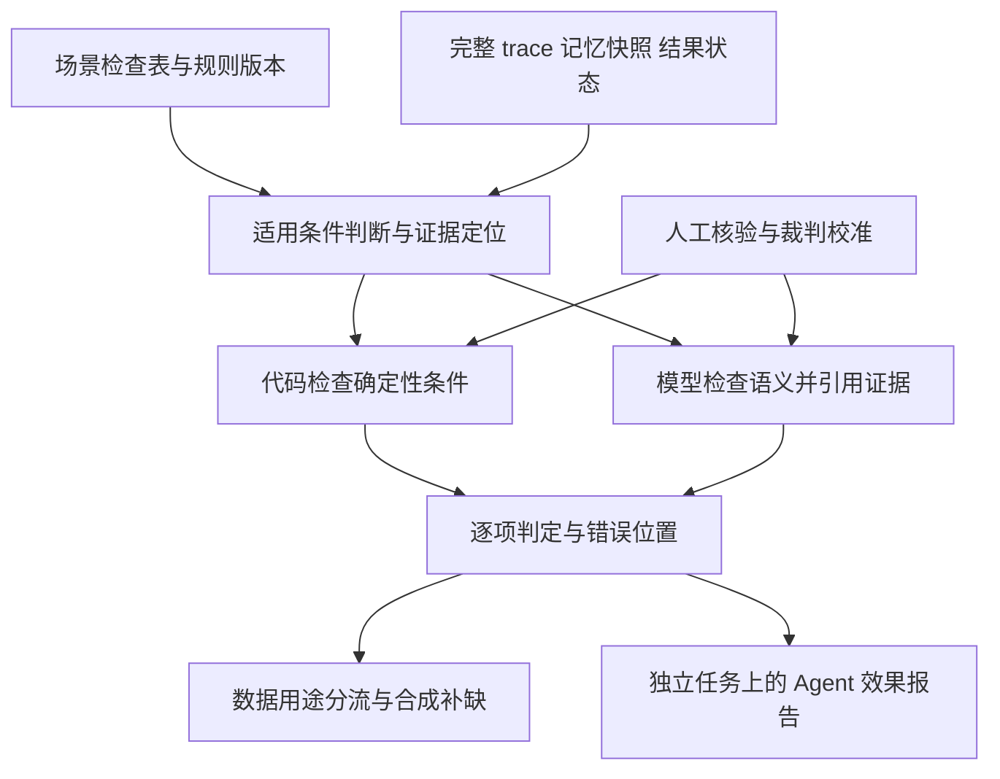

# 评估系统：用共同标准连接数据生产与 Agent 效果验证

最近更新：2026-11-04（Asia/Shanghai）。状态：研究与设计建议，尚未实现或在本项目数据上验证。脱敏摘要及数据侧补充明确当前输出止于推荐集合，历史推荐计数不能作为下游结果；仍没有合作方代码、原始逐条样本、完整评审配置或执行环境。当前可落地的推荐层设计集中在第 13 节；前文包含未来取得执行证据后的方法，不能当作当前样例必须具备的字段。项目背景和变化记录见 [项目说明](README.md)，数据入门流程见 [入门指南](architecture-and-technical-options.md)。

**1. 本次要解决的问题与结论**

用户明确提出两个用途：评估系统指导训练数据筛选与合成，并用于优化／训练后 Agent 的效果评价；两者需要一致标准。用户反馈，过去用意图准确率、事实准确率等宽泛标签让模型打分，实践中不能有效定位问题。这是用户经验，尚未取得当时的样本或评审配置，不能断言具体故障原因。

建议把评估的基本单位从“整条 trace 的几个总分”改为“案例中的可核验要求”。每项要求说明：什么情况下适用、可接受行为、必须查看的证据、检查方法、违反后的影响。意图／事实等标签保留作汇总分类。

共同标准指相同的正确性定义、证据要求、规则 ID 与版本，不意味着训练和最终评测共用题目，也不要求所有用途使用同一个模型裁判。筛选还需考虑示范价值、覆盖和数据质量；模型评价还需覆盖失败、遗漏及真实任务分布。

**2. 为什么宽泛标签容易失效**

| 问题 | 在本项目里可能发生什么 | 设计上的修正 |
| --- | --- | --- |
| 标签缺少案例条件 | “意图正确”没有说明当时是否应该行动、是否可等待 | 将意图拆成具体行动条件与允许选择 |
| 把事实等同于自述 | 摘要内容正确，但“已安排推送”并没有任务记录 | 内容事实、执行状态分别验证 |
| 过程与结果混合 | 最后成功掩盖中途重复打扰；工具超时被误归因于记忆理解 | 分别保留结果、过程违规、环境异常与恢复情况 |
| 长 trace 被整体印象主导 | 最后一句承诺遮盖较早的错误调用 | 按具体要求定位事件，保留原始上下文 |
| 总分抵消关键错误 | 内容好看抵消违反免打扰时段 | 必须条件单独判定；表达质量在合格候选中比较 |
| 裁判未经校准 | 模型擅长写点评，但错误放行与误杀比例未知 | 用人工核验样本验证裁判本身 |

这些是解释当前方法局限的候选机制，不是对尚未看到的旧系统作实测诊断。细化标签数量本身无法解决证据与判定标准问题。

**3. 可借鉴的方法：哪些能直接用，哪些适合预研**

下表是本轮读取的论文／官方资料及其迁移判断。成熟度指方法在本项目的可实施性，不代表已经比较所有方法或证明性能最优。

| 方法与一手来源 | 原工作提供什么 | 我们怎样用 | 条件与限制 |
| --- | --- | --- | --- |
| [τ-bench](https://arxiv.org/html/2406.12045v1)，2024／ICLR 2025 | 根据交互后的数据库状态判定任务结果，并检查多次尝试的可靠性 | 查询排程、推送回执、产物等结果证据；区分说完成与真完成 | 要有相应状态接口；状态相同不能覆盖所有过程错误 |
| [Anthropic Agent 评估实践](https://www.anthropic.com/research/demystifying-evals-for-ai-agents)，2026-01 | 区分任务、尝试、trace 和最终状态，组合代码、模型与人工检查 | 采用组合检查器；用人工校准，并允许有效的不同完成路径 | 工程方法参考，不能直接给出我们的个性化服务真值 |
| [LangSmith 复杂 Agent 评估](https://docs.langchain.com/langsmith/evaluate-complex-agent) 与 [AgentEvals](https://github.com/langchain-ai/agentevals/blob/main/python/README.md) | 终局、轨迹、单步骤评估；可配置调用匹配与模型评审 | 可复用工具参数匹配、实验比较和 trace 查看能力 | 默认 trajectory accuracy 提示词不自动解决业务标准；严格路径匹配仅适用于确实固定的流程 |
| [AgentRewardBench](https://arxiv.org/html/2504.08942v2)，COLM 2025 | 用专家标注评估自动裁判；揭示模型过度认可成功、规则遗漏有效解法等问题 | 建立“评估器的评估集”，分别测错误放行与有效轨迹误杀 | 原证据来自 Web 任务和当时模型，不是当前手机 Agent 的误差估计 |
| [AgentRx](https://arxiv.org/html/2602.02475v2)，2026-08 修订 | 从工具规范、政策和轨迹前缀产生约束，生成有步骤与证据的违规记录，再定位失败 | 借鉴先检查、再诊断；先人工制定规则，再考虑自动提出规则草稿 | 属于值得预研的方法；生成约束和根因归属都可能错，不能直接当可靠标签生产器 |
| [LongMemEval](https://arxiv.org/html/2410.10813v1)，ICLR 2025；[MemoryAgentBench](https://arxiv.org/html/2507.05257v1)，2025 | 前者覆盖提取、跨会话、时间、更新与拒答；后者强调增量交互、检索、学习、长程理解与冲突处理 | 用于制定记忆能力覆盖表与诊断题 | 记忆问答正确不等于服务决策正确，更不能代表手机执行成功 |
| [PARE](https://arxiv.org/html/2604.00842v1)，2026-04 | 主动用户模拟，分别观察提议、接受与执行结果 | 区分需求判断、主动介入和后续执行 | 模拟用户接受不是现实用户满意；当前只借鉴评价结构，不要求先搭环境 |
| [MemoProBench／MemoProAgent](https://arxiv.org/html/2610.22671v2)，2026-10 | 在长期记忆与第一视角视频下联合评价内容、触发时机及重复介入 | 借鉴同时检查该说什么、何时行动、是否重复，并做记忆／时机的分离诊断 | 近期预研；视频场景不等于本项目，单窗口恰好一次等规则不能直接照搬，论文描述的发布计划也不等于已验证可下载运行 |

本轮推荐先采用“明确要求＋结果验证＋关键过程检查＋人工校准”。自动根因分析、自动生成检查规则、训练专用评审模型可后续研究。纯参考答案相似度、整条调用序列精确匹配或单模型综合评分均不适合作为唯一依据。

**4. 共同标准怎样定义：每个场景一份检查表**

一份检查表包含六项：初始情境和观察区间；当时可用记忆及来源／有效条件；允许的行动或结果集合；必须满足的约束；每项判断所需证据；规则与案例版本。

先分三类要求：

1. 必须条件：例如明确免打扰时间、事实不能捏造、不能无必要地重复交付同一事项。是否允许再次提醒由案例中的有效约定决定；违反必须条件后不能靠其他优点抵消。
2. 任务达成：例如摘要产物合格、排程确实建立。任务是否要求排程，必须由本案例的服务约定确定。
3. 可比较的质量：例如两份均合格摘要哪个更有用、更简洁。使用有例子的分档标准或盲评成对比较，允许平局和无法判断，不强行定义唯一最佳回复。

主动服务的“应做什么”需要来源。可来自用户明确偏好、已启用的服务约定、可核验的任务状态，或经过人工确认的合成设定。仅凭弱行为信号推测用户喜欢什么时，应允许多个合理选择，不能把生成器的猜测升级成真值。人工推断也要标明依据与不确定性。

评估案例应有“应提供帮助”“适合等待／不介入”“需要更多依据”几类。最终评测时 Agent 只看到正常情境和记忆；不把评测器的隐藏目标答案、触发窗口或未来用户反馈给它，否则会把主动判断退化成按答案执行。

**5. 整体结构与最小接口**

先实现四个小模块即可：读取并关联原始记录；管理案例与检查项；执行检查并记录证据；汇总和导出。JSONL／Python 即可，现有 trace 平台能复用则复用，不先建设训练器或大平台。

原始 trace 完整保留。模型评审可按检查项读取相关片段及依赖上下文，需标明覆盖范围并能回查原文；不能只根据最终回复或有损摘要断言整条轨迹没有违规。证明“没有发送／没有重复”尤其需要完整覆盖相应观察区间的日志或权威状态记录。

每次检查输出以下记录，作为候选格式而非已确定接口：

| 字段 | 内容 |
| --- | --- |
| 关联信息 | case_id、run_id、check_id、规则版本、评审配置版本 |
| 判定 | PASS／FAIL／UNKNOWN／NOT_APPLICABLE |
| 位置与依据 | 相关事件或步骤 ID、记忆 ID、原文片段／状态记录引用 |
| 说明 | 具体违反了什么或还缺什么证据，避免只有“事实错误” |
| 影响与去向 | 是否违反必须条件；是否需复核；对示范／诊断／候选任务的用途影响 |

UNKNOWN 是证据不足；NOT_APPLICABLE 是该条件在此情境不适用；检查器调用失败另记运行错误，不能伪装为 Agent 失败。模型自报的置信度未经校准，不作为自动放行的可靠概率。

代码适合检查参数、时间、状态、对象一致性、确定的先后关系和重复记录。模型适合检查“近期工作日”的语义适用、摘要是否忠实于材料、服务与偏好的关联，但必须指出证据；复杂或冲突情况进入人工复核。比较两份都合格的输出时，再使用匿名、交换顺序的成对评审。

**6. 一个具体 trace：如何比总分更有用**

本节演示取得执行证据后的完整评价。当前已知业务材料来自上游推荐环节，因此不能把下述虚构执行 trace 当成已取得数据，也不能要求所有推荐入口提前完成下游任务。

下述内容全部虚构。沿用阅读推荐案例，额外明确用户已启用“每天 08:30 简报”服务，避免把“必须提供简报”当成未说明假设。记忆包括：喜欢 AI 研究；近期工作日先看摘要；22:00—08:00 不推送。时间按用户时区解释。这里观察夜间准备阶段，次日实际送达另需继续观察。

| 事件 | 可见记录 |
| --- | --- |
| e1 | Agent 输入中已包含上述有效偏好、免打扰时间和每日简报约定 |
| e2 | Agent 生成了与原文一致的短摘要 |
| e3 | 23:05 调用立即推送工具，回执确认该摘要已发送 |
| e4 | Agent 声称“已安排明早 08:30 推送” |
| s1 | 本轮结束后的完整任务状态查询确认，没有对应的次日排程 |

| 检查项 | 判定与证据 | 能说什么／不能说什么 |
| --- | --- | --- |
| 使用当前工作日摘要偏好 | PASS：e1、e2 及原文 | 内容形式符合；不代表所有记忆都用对 |
| 遵守免打扰时段 | FAIL：e1 的限制与 e3 的发送时间、回执 | 可以定位 e3 违反约束；不能据此臆测隐藏推理 |
| 夜间准备阶段建立正确排程 | FAIL：s1 未建立所需排程 | 若只是 trace 没看到创建调用、缺少状态查询，应为 UNKNOWN |
| 如实报告执行状态 | FAIL：e4 与 s1 冲突 | 自述不能覆盖实际状态 |
| 用户是否满意 | UNKNOWN：没有相应反馈 | 不用模型模拟满意度冒充真实反馈 |

判定可以指出：关键记忆已经进入上下文，e3 的行为仍违反它；e4 又给出不符合状态的完成声明。这比“意图 4 分、事实 3 分”更能指导补充数据。它仍不足以证明错误来自某个内部模型模块。

该整条轨迹不应成为“成功执行”的 SFT 示范。经过核验的摘要片段可以按独立用途保留，但要保留来源、输入与上下文；不能直接裁出成功片段就宣称整条任务成功。修复 e3 后如需宣称执行成功，要从一致状态重新执行，不能只改文字、沿用旧工具回执。

**7. 从 trace 定位问题：检查可见链路，不编造根因**

建议沿以下链路检查，分类可多选：

| 环节 | 所需证据 | 可能的诊断 |
| --- | --- | --- |
| 原记忆／历史中是否有正确事实 | 当时的源记录与记忆快照 | 未记录、失效、内容抽取有误 |
| 相关信息是否被返回并送入上下文 | 检索结果、过滤／截断记录、实际模型输入 | 检索遗漏，或检索后未传入 |
| 决策是否符合已可见记忆 | 决策前可见输入与实际动作 | 条件误用、忽略更新、缺少依据仍断言偏好 |
| 工具动作是否实现计划 | 工具定义、参数、结果与状态 | 参数错误、工具返回误读、环境故障 |
| 最终结果与后续交付是否成立 | 产物、排程、送达、后续状态 | 未完成、重复、错误时机、错误完成声明 |

不要强制 Agent 每次显式引用记忆 ID，也不要强制每次调用检索工具；信息可能已经在上下文里。判断依据放在标注侧，行为是否合适由可见证据验证。

检查必要里程碑与先后约束即可，不要求复制参考 trace 的全部步骤。失败后合理重试并恢复可以是合格行为；越过重要时间约束后再成功，不能抹去已发生的打扰。

“首次可见错误”“导致失败的关键错误”“最后的错误症状”应分开。静态 trace 的诊断通常是有证据支持的归因候选；要声称某一步修复能改变结果，需要可控重放／干预。只缺日志时明确写未知。

**8. 同一标准在两种用途中的使用方式**

| 环节 | 使用共同标准的方式 | 额外判断 |
| --- | --- | --- |
| 筛选 SFT 数据 | 检查候选表现是否满足适用要求，关键条件未通过或未知的整轨迹不作为已验证成功示范 | 输入完整、来源可信、覆盖与重复程度；成功但没有记忆难点的样例不一定最有训练价值 |
| 合成数据 | 从失败类型或覆盖缺口生成场景，再更新检查项、生成候选并独立核验 | 场景可解、条件一致、来源显式为合成；生成器给出的答案不是裁判真值 |
| 构造偏好对 | 同一输入下，用明确证据说明哪条更好；优先比较满足必须条件后的质量 | 保留平局、不可比较；不能只按同一模型总分排序 |
| 提供 RL 任务规格 | 给出有效初始状态、任务条件及可验证结果 | 当前 Agent 失败的任务仍可能有训练价值；评估记录不自动等同可直接使用的标量奖励 |
| 训练后评测 | 新旧 Agent 在独立情境上重新运行，以固定规则、观察区间和资源条件评价 | 报告全部尝试、稳定性、错误类型及评价覆盖；不只重评训练样本 |

共同规范可以公开给数据生产流程，最终测试的具体案例和答案隔离；同源故事、用户历史、变体与前缀按家族切分。训练侧优化检查器可以较轻，正式评测增加状态核查与人工抽检，但必须保留相同正确性含义，并在共同校准集上检查是否有系统分歧。更换裁判或规则版本时，旧模型也要重评，避免把尺子变化当模型进步。

合成时推荐先做受控变化：明确更新当前偏好时，相关行为应改变；添加无关记忆或同义改写时，关键行为应稳定；加入已交付记录时检查是否不必要重复。删除某段记忆后先核查是否还有其他有效依据，不能规定所有“无记忆”场景都必须沉默。

最终判断要有独立样例及抽查机制，防止反复优化后迎合裁判漏洞。只增加第二个模型或多模型投票并不自动带来独立真值。

**9. 怎样评价优化后的 Agent，避免被指标误导**

先报告一组小而可解释的结果，不先压成一个加权总分：

| 结果 | 建议统计对象与含义 |
| --- | --- |
| 已确认任务成功率 | 在固定观察期内满足任务要求和必须条件的试运行数／预先定义的有效试运行总数；证据不足单列，未确认不能计成功 |
| 不恰当介入与遗漏帮助 | 分别在人工确认的“不应介入”和“应提供帮助”的场景／机会窗口中统计；明确同一机会的去重规则 |
| 关键约束违反 | 各项约束适用的运行中，实际违反的比例；不能被其他高分抵消 |
| 记忆相关错误分布 | 按更新、条件、证据不足、干扰等分层，并报告样本数；不同切片可重叠 |
| 判定覆盖与未决问题 | 可判定、UNKNOWN、评审错误及环境异常数量；日志质量改变也会影响表面成功率 |
| 成本与稳定性 | 同任务的时延、调用次数、资源消耗和多次尝试分布，避免用更多重试换来未注明的收益 |

另报告总尝试数和剔除理由，预先定义环境无效的处理方式，不把失败随意排除。成功率的分母不能只包含已经发出推送的样本，否则漏掉未提供帮助的场景；也不要用大量“保持沉默”的时间点稀释错误。覆盖测试用于暴露问题，接近业务分布的测试用于估计整体表现，两者分别报告。

比较新旧 Agent 时保持输入记忆、工具、时间、系统提示、资源预算、运行起始状态和评价版本可比；若多项同时变化，报告系统改进而非单独归功于训练。按同一任务配对比较，有波动的任务重复运行；数据扩大后按独立任务／用户家族估计不确定区间，同题多次运行不能冒充更多独立题。

分开做“给定正确候选记忆的决策评估”和“实际记忆系统接入后的端到端评估”。前者定位看到之后是否用对，后者包含检索和执行；差距有助诊断，但不是精确的因果分解。

离线 trace 重评只能检验已有行为；固定历史前缀可检查新模型下一步选择。要证明新 Agent 的整体执行效果，仍需在可重置环境或合作方真实评测接口中重新产生后续交互；新动作改变环境后，不能继续喂旧工具返回并称作端到端结果。

评估原有决策时只用当时可获得的证据判断是否合理；后续结果用于验证完成状态，不能让模型因“不知道未来”而被判错。真实满意、长期帮助和打扰成本最终需要合作方的用户反馈或上线对照；未点击不自动等于不满意，模拟用户评价也不能替代真实反馈。

**10. 先验证评估器，再扩大数据生产**

建议沿用上轮约 20 个种子案例的试做规模，把每个案例写成“输入＋允许结果＋检查项＋证据”。数量可调整，用于发现规则分歧，不足以宣称评估器已达到生产精度。

1. 准备有区分力的正反例：结果正确但路径不同；内容正确但时机错误；声称成功但状态失败；证据缺失；工具暂时失败后合理恢复；旧偏好被明确更新；无必要介入和应该帮助但遗漏。没有真实 trace 时先用标明合成的样例，之后补真实审核集。
2. 独立人工判断一批样例，记录分歧并裁决。条件允许时由两名熟悉场景的人标注；只有一人时明确参考标签仍待交叉复核。先解决标准歧义，再用它评价模型裁判。
3. 在相同样例和原始证据条件下比较三种方案：旧的宽泛标签评分；案例检查项的模型评审；代码验证加证据定位的语义评审。记录新增上下文、调用次数、人工耗时，不能只比较总准确率。
4. 分别检查错误放行、有效解法误杀、无法判定比例、错误位置／类型是否命中人工核验，以及判断引用能否真正支持结论。按正常／异常、记忆类别、trace 长度分层；不直接使用模型自报置信度。
5. 用不参与提示词调整的样例检查裁判泛化，并在新 Agent 版本上抽查。调规则的样例不能兼任最终证明；模型在 trace 中的自我表扬或要求打高分的文字不能成为裁判指令或成功证据。

最终上线阈值由错误后果、人工预算和实际校准数据决定，本轮不凭空指定“准确率 95% 即可”。单一整体准确率可能被多数正常样本掩盖；数据筛选尤其要知道“放行样例中有多少实际上不合格”。

最先应交付的四件东西是：案例检查表、人工核验样例、逐项评价记录格式、面向数据与模型的两种汇总视图。评估器雏形在方案明确后实现；暂不启动训练或大规模合成。

**11. 优先保留的三个预研问题**

1. 证据定位是否真的改善评审：与宽泛评分及仅细化提示词比较，观察错误放行／误杀和诊断定位，而非只看点评更详细。
2. 受控记忆变化能否发现表面个性化：关键变化与无关变化成对构造，检查动作变化是否符合预定关系。它是行为诊断，单次对照不能证明完整内部机制。
3. 自动约束／根因分析是否值得成本：在固定规则已可靠后，让 AgentRx 类方法提出候选检查和错误位置；人工核验其增量覆盖、错误诊断和费用，再决定是否纳入生产。

这些方向都服务当前的数据职责。训练专用评审模型、复杂多裁判系统和完整手机仿真环境不作为起步前提。

**12. 本轮证据与状态**

2026-11-03 核验了第 3 节所链接的一手资料，重点阅读方法、评价结构和局限；AgentEvals 的 Python README 读取到第 185 行，blob SHA 为 `80e7fec64fe8c16f65cd282d075210f4e3fd04c6`。未安装、运行或复现这些项目，论文里的收益不是本项目结果。

当前已明确：用户要求评估承担数据生产与最终效果验证两个作用。候选方案：共同规范、多种证据检查、分用途使用、独立校准与留出评测。尚待真实材料明确：可取得的 trace 与状态字段、合作方认可的服务标准、运行与人工审核接口。以上不阻塞规范草案讨论。

**13. 业务评测报告怎样接入（2026-11-04）**

用户先转述汇总，随后提供完整脱敏技术摘要和数据侧结构核查。当前任务是读取多源记忆、当前情境、能力清单与历史推荐池，生成推荐集合及交接给下游的任务；output 止于该集合。历史推荐附有曝光／点击计数，不是下游产物回流。评价涉及逐推荐项、逐卡引导语与整个集合，量程统一，流程自动化。尚无完整分档规则、原始逐条案例或评审配置；下游执行和真实满意证据不在当前数据里。上述为材料提供方说明，本方未独立审计原始记录。具体业务数值、来源原文与详细评审仅本地保存，不并入公开文档或外部检索。

1. 已明确以一次完整推荐集合为任务与数据划分单位，内部有逐推荐项、逐卡引导语及整组三种评价对象。引导语逐卡这一点已由数据侧补充；其聚合、实际模型输入与评分字段来源仍待核验。可检查推荐和交接描述，不能据此确认检索、执行或送达成功。
2. 量程与简要含义已知，满分锚点、权重、门控和缺省规则仍待核验。统一量程有助于读分布，但不自动意味着不同构念等难度或等业务价值。空值不作零，总分阈值不自动作成功线，极低分还需区分真实失败与评审／运行异常。分层均值不能直接证明记忆供给的因果作用。
3. 从逐条理由提炼候选检查项。用匿名案例记录“情境与记忆依据 → 实际表现 → 原得分和理由 → 候选要求 → 可验证证据 → 复核状态”。从低分、高分对照及边界例检验适用条件。原理由可能有偏差或不一致，不能当作官方定义或人工真值。
4. 业务指标继续作为对照报表，增加证据和诊断字段，不急于替换整套评分。若原评语说证据不足，分别核验源信息、检索、模型输入、条件理解和行为结果；不直接归因于记忆训练不足。主动性也不是越高越好，确无前瞻机会时应考虑不适用。
5. 先用允许描述的少量案例校准标准与评估器，再决定数据用途。不能仅按高分选 SFT，不能将不同输入的高低分样本直接配成偏好对，也不能将未校准总分直接作为 RL 奖励。合成围绕核实后的错误机制，而不是反复迎合原评分器。
6. 按用户／任务／变体家族分离用途。用于还原标准、调整裁判和生成训练样例的案例归入开发；保留未参与调优的独立评测来源。若整批已用于开发，后续需另取独立样例。数据是否足以支持收益判断取决于独立性、覆盖和效果大小，而不只是数量。
7. 当前先建立输入输出层面的检查，范围限于已有证据能支持的关联、约束、表达及事实依据；若连事实来源也没有，不能将“看起来可信”标为事实已核验。没有 thinking 不阻塞这类工作，不索取或补造隐藏推理。未来与合作方对齐实际输入、记忆来源和时效、工具参数与返回、结果状态、关联 ID 与终止状态，以扩展为执行评估；打点建设的具体分工另行明确。

当前已可制定推荐层评测规格草案。首个验证动作建议使用字段填全、可人工判定的少量虚构案例，说明评分为何成立及所需证据；现有占位骨架不能代替这种案例。对业务材料只完成了摘要阅读、部分文内算术核对和候选解释审查，没有逐条诊断或复现原始分数。

**现有评价维度的复用建议。** 建议保留业务维度作为沟通和历史对照入口，在下面建立案例检查和证据记录。按维度评分并给理由的形式本身可用，可靠性取决于定义、证据、适用性与校准；已知流程自动化，仍不知道具体评审器及校准方式，不能将自动生成的理由当作真值。

对维度名称相近的项目，先明确评价对象与层级再决定是否合并；同一底层检查可支持多个业务视角，但不应未经分析重复加权。对包含两个目标的维度，底层分别检查，避免一个得分掩盖相反表现。区分内容可操作和工具实际执行、信息时效和服务时机、同批去重和历史重复、事实正确和个性化依据充分。

原定义尚不完整时，不预设各类情境都必须体现隐含需求或前瞻性。明确何时应推荐、何时适合等待；无适用机会与证据不足分别处理。核查现有规则是否覆盖记忆更新／条件使用、建议介入时机／频率和承诺边界，再补缺，不先堆新顶层指标。真实执行结果留待另有证据时评价，当前不因缺少执行记录而判推荐失败。

建议同一评估保留业务视图与证据诊断视图：重要必须条件单独判定，开放质量使用带示例的分档或成对比较，缺证据允许未知。现有总分和原理由原样保存，在量程、权重、缺省处理明确并经校准前，只作为选例和研究线索，不直接作为训练正负标签或奖励。若改变规则，应标新版本并对共同案例重评，避免混淆尺度变化与能力变化。以上为当前建议，尚未改变业务方标准或实施重评分。

**推荐阶段的职责与评分可达性。** 数据侧补充说明，相关结果维度评价拟交付任务的形态，而非真实执行结果。此前关于阶段职责的疑问已部分得到回答；确切被评字段、分档锚点，以及如何认可“有结论的任务”仍需正式规则和案例。建议评价需求依据、任务价值、交接描述及承诺边界，既不要求入口凭空完成下游分析，也不因提示词写了“给出结论”就认定结果一定有用。硬事实如何支撑推荐的要求仍待确认，事实可信不以“包含数字”为充分或必要条件。用户明确提供背景事实，也不意味着用户明确请求了由此推导的服务。无需唯一 golden 文案，但需要可接受结果、必须约束与人工核验的参考判定。

**分层判定及数据单位。** 推荐项检查依据、标题与交接任务的一致性、必要条件是否明确、能力说明是否支持；每张卡的引导语检查是否虚构用户事实、过度承诺，以及是否呼应该卡推荐；集合检查有效需求覆盖、排序、历史与组内去重、数量是否必要及静默适用性。引导语是卡片属性，与同卡推荐项关联，不另当独立整例。统计分别使用案例、卡片与推荐项分母；不能把全部维度乘推荐项数当作独立样本量或奖励数。原业务门控若整例否决，仍保留细粒度违规和其余检查结果。导出局部样例时保留父案例与同组上下文，修复后复核整组和对应引导语，不能以局部评分之和代替集合质量。

**记忆与观察性数据的使用。** 无损保留显式事实、模型归纳、索引和历史推荐的来源与时间，区分缺失、空、不适用、占位和未展示。将原来可能被误称为产物的内容按数据侧修正记为推荐历史；不凭层级名称补造独立执行产物或重复计算同一来源。入口按设计没有的字段不应补造。模型推断不是用户明说，过去推荐不等于接受、执行或完成。来源类型标签不能代替对实际记忆依赖的检查。

曝光／点击的统计须区分记录有字段、值为零、值为正及缺失；历史记录是否跨案例重复、计数的时间窗口和刷新时点未知时，不能直接计算事件级点击率，更不能默认是独立反馈。旧记录中的后续累计反馈也不能回填到更早模型决策输入。计数不一致保留并标待核对，不自行改成合理值。即便曝光记录有效，未点击也不足以证明拒绝；判语提及点击的次数不足以说明其实际权重或模型决策因果。

“不要无意义地重复推荐”可以独立于用户偏好成立，但需要比较同一需求、时间、实质新增内容及服务约定。“用户明确拒绝该任务”则需对应范围内的明确证据。反馈稀疏是观测约束，将未点击当作强负例是可以修改的评价与标注选择。候选处理表如下：

| 输入证据 | 可以检查什么 | 不应直接推出什么 |
| --- | --- | --- |
| 已存在相同任务的历史推荐 | 是否重复、是否有新价值、是否符合提醒约定 | 用户拒绝、任务完成 |
| 曝光计数为正且点击明确为零 | 保留弱观察，结合上下文判断再推荐必要性 | 用户不喜欢、用户实际认真看过 |
| 点击缺失或计数定义不明 | 标反馈未知 | 将未知填成零或作为负例 |
| 有点击记录 | 在有效统计口径下有选择痕迹 | 执行成功、满意或长期偏好 |
| 用户明确取消，当前仍有效且指向同一需求 | 不继续推荐被取消的任务 | 拒绝所有相邻主题或无关服务 |

首个案例组建议围绕同一需求：仍有效、已明确取消、仅有历史推荐而反馈未知、加入无关信息。预期应变化／保持稳定的条件先人工核验；同时保留其他有效需求，避免只学习静默。对历史重复的处理要说明具体约定，未确认时不擅定冷却时间或一律禁止重推。

**数据生产的候选顺序。** 先校准评估，再利用核验过的反馈生成修复候选；确认输入依据和整个集合合格后，导出真实目标格式的 SFT 示范。导出前确认原生模型响应与评审包装的边界：分数、否决标注、总分和评语若为后加字段，应留作评价元数据，不进入默认生成目标，也不泄漏给待测模型。字段仍待核验时保留原文，不能宣称已建立可训练 schema。若同输入下存在可比的两个候选，再导出有依据的偏好对；不能靠未点击自动构造 rejected。多维分数不自动成为 token 奖励。

当前评分最多是待校准的推荐质量代理，不是已证明有效的训练 reward 或真实执行收益。推荐层 SFT 和后续基于生成集合评价的优化，并不以取得下游 trace 为必要条件；采样、标量奖励和训练实现由同事协作完成。保留失败任务作为诊断和修复素材，不直接优化未经校准的总分。训练前后在独立输入、相同能力说明与固定评价版本下重新生成完整集合，分别报告推荐项违规、引导语问题和集合遗漏／重复；可以支持推荐能力结论，不能据此声称真实满意度提高。

**还需补充的最小信息。** 优先明确评分针对哪些输出字段、分档锚点和门控／聚合，评审器能看到什么；随后补少量完全虚构但字段填全的案例，以及合法空输出、任务交接、必要能力说明和匿名来源分组协议。当前不需要原始用户数据或隐藏推理，也不必等待完整执行环境才能讨论并形成规范草案。

用户先前说明不掌握具体评分规则，需要向业务方获取；本轮数据侧补充已解决 output 边界、逐卡引导语和结果维度的任务形态解释。仅剩具体规则等依赖记为“待业务方提供”，不重复询问已确认边界。可供后续沟通的精简清单如下，无需一次补齐：

1. **字段与判定对象**：提供输入、原生模型输出与后加评审字段的字典，明确“有结论的任务”“硬事实支撑”的具体被评字段及合格例；补合法空输出格式。历史计数另确认缺失／零、窗口、去重和刷新时点，后续使用行为反馈时再补事件关联，不阻塞当前证据检查。
2. **怎么判**：优先提供实际使用的评分提示词／配置及版本，可去除业务内容；需要看到评审器输入字段、各档锚点、不适用／缺失的处理、门控触发与作用范围、总分聚合方式。若只能先给一部分，优先覆盖上述存在职责疑问的维度和关键门控。
3. **一个判分实例**：提供一个内容填全的虚构输入和整组输出，由业务方按当前规则说明逐项分数、依据、门控及最终总分，便于核对规则怎样落到实际结果；这一例仅用于解释规则，不足以验证评审器可靠性。

等待期间可继续形成不依赖评分权重的结构与证据规范草案：保留案例、卡片、推荐项的父子关系，标明记忆来源与时间，区分可核验结论、待确认假设和未知状态。候选行为检查须注明依据和适用条件，不直接替换业务判分；现阶段不据摘要确定筛选分数线、奖励权重或自动接纳训练数据。本轮未联系业务方、实现或运行评估。
