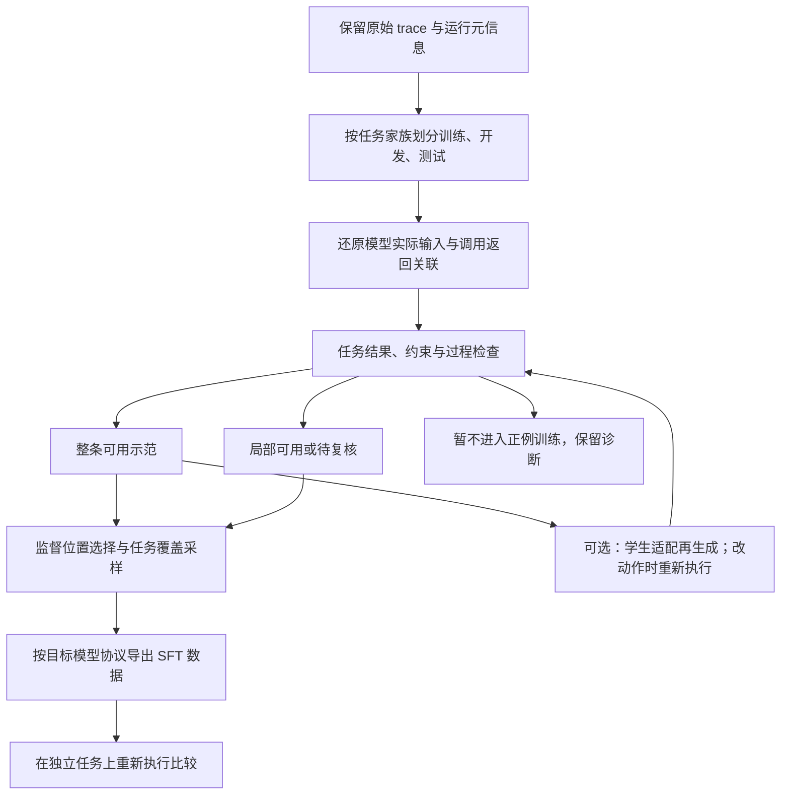

# 完整执行 trace 的筛选与 SFT 数据构建：研究与实现参考

更新：2026-11-09；广泛检索截止 2026-11-06，本次定向复核 FWS 与 SmartAD 的方法条件。按用户要求，暂时放下此前推荐业务的限制，假设已有 OpenClaw 类 Agent 的任务执行 trace，研究怎样选出更有训练价值的数据。本专题不表示已取得新的业务 trace，也不改变此前分工。沿用仓库 research skill：区分论文报告、代码阅读、设计建议与实际实验。已核验论文、官方项目和部分源文件，未安装项目或复现训练。

11 月 6 日推进：用户随后明确手头有强教师模型的 harness trace，包含实际输入、thinking、工具调用和返回，要求下一工作周交付给 Qwen 27B 的 SFT 同事；最终质量评估尚未运行，环境未搭好，当前先跑通 demo。具体取舍见 [首版交付方案](teacher-trace-to-qwen-sft-plan.md)。下文的成功筛选、学生适配与质量对照为完整研究路径，不作为本次格式转换 demo 的前置条件；本助手尚未读取该批原始数据。

2026-11-09 接续讨论确认：现网每个 case 只有一条 trace，任务和用户背景各不相同。普通离线 SFT 可直接利用；SmartAD 的同题选择当前无可比较候选，不再作为默认下一阶段。FWS 可从单条专家示范出发，原论文不需要 harness；改工具动作的 Agent 迁移才涉及环境执行，详见交付方案第 2.1 节。

## 1. 当前判断

建议把问题拆为四项：**选哪些轨迹、监督其中哪些动作、怎样将专家示范转换成更适合目标学生的轨迹、怎样组合整个训练集**。仅按最终成功或一个 LLM 总分取 Top-K，容易留下侥幸成功、错误重试、泄漏答案的轨迹，同时排除必要探索、有效恢复和较难任务。

同日补充依据：用户指出《Finetuning with Sampling: SFT Learns Better Than You Think》。初版检索偏重 Agent trace 的结果／过程筛选，没有充分展开面向学生模型的数据分布适配，遗漏了该工作；此次已核验论文、附录和官方采样代码。该方向应独立纳入研究，不能仅作为已有“质量评分”的另一种特征。具体分析见第 2.1、4.6 和 6 节。

“高质量”至少涉及四个独立问题：

| 问题 | 需要的依据 | 不足以替代的信号 |
| --- | --- | --- |
| 任务是否完成 | 初始状态、实际产物／状态变化、任务检查器或可核验评价 | Agent 自称完成、工具 HTTP 成功、文件存在 |
| 行为是否可靠 | 当时可见信息、调用参数、返回、约束及动作之间的依赖 | 无报错、过程短、措辞自信 |
| 是否适合学生模仿 | 学生能获得的工具与上下文、可解释的决策、有效监督位置 | 教师本身排名高、输出长、训练 loss 低 |
| 是否增加数据价值 | 任务／环境／技能／难度覆盖、与已有样本的重复程度 | 每条独立高分、样本总量大 |

这些维度不宜立即压成一个总分。先用确定性条件识别不可用记录和明显错误，再在可用池内比较过程质量与覆盖。已验证成功的数据适合作为易解释的起步基线；弱验证和失败数据保留独立来源与用途，通过后续对照判断是否值得加入。

## 2. 最值得优先阅读的研究

下表中的提升均为原作者报告，实验设置不同，不能横向排列成算法排行榜。“已查仓库”表示阅读过文件，不表示本地跑通。

| 工作与时间 | 机制与直接证据 | 实现状态与迁移限制 |
| --- | --- | --- |
| [Finetuning with Sampling: SFT Learns Better Than You Think](https://arxiv.org/html/2610.02140v1)，2026-10 | 用专家信息引导候选生成，再依据目标学生的分布调整示范，保持常规 SFT 目标；将“对谁容易学习”纳入数据构建 | [代码](https://github.com/aakaran/finetuning-with-sampling)；已查采样与评分实现。实验是化学、数学和医学问答，尚未验证多工具 Agent；理论采样与实际近似需区分，详见第 2.1 节 |
| [SmartAD](https://aclanthology.org/2026.findings-acl.1349/)，Findings ACL 2026 | 从同题多个正确教师候选中按学生 NLL 选择，并采用动作／决策分段加权；对各 assistant 回合先算平均 token NLL 再对回合平均 | 已读论文方法；本轮未确认官方代码。主要为 1.5B／3B 的 QA、数学工具任务；需要同题候选与可接受性判断，不能全池最低 loss 取样或自动推广到 27B |
| [SCoRe](https://proceedings.mlr.press/v306/lyu26j.html)，ICML 2026 | 由学生产生轨迹，教师纠正最早关键错误，再进行 SFT 和短时程 RL | [代码](https://github.com/haruhi-sudo/SCoRe)；已读 README。可借鉴纠正数据生成模块，但需要学生 rollout 和环境；整体收益不能归因于 SFT 单阶段 |
| [OpenThoughts-Agent / Data Recipes for Agentic Models](https://arxiv.org/html/2606.24855v1)，2026-06 | 对任务来源、混合、教师和 rollout 筛选做系统消融；多轮轨迹过滤的收益在 token 预算对照下仍存在。任务来源和教师选择也明显影响训练效果 | [代码、数据、模型](https://github.com/open-thoughts/OpenThoughts-Agent)；已查 README。覆盖多种 Agent benchmark，但主要生成接口是 terminal；不要把其“至少 5 轮”变成通用硬门槛 |
| [TQS：Quality, Not Just Outcome](https://arxiv.org/html/2610.13152v1)，2026-10 | 在成功轨迹中用可计算过程特征筛选。各 1,024 条训练时，SWE-bench Verified 随机选择 24.8%，TQS 27.6%，LLM judge 28.4%；长度匹配的 TQS 为 27.0% | [代码](https://github.com/DuHeng0128/TQS)；已查 README、评分指南。适合廉价基线；主要训练结果为单次运行，不能称其胜过 judge 或已普适验证 |
| [SWE-Prime](https://arxiv.org/html/2608.27449v1)，2026-08 | 先选有质量与代表性的轨迹，再选有价值语义片段；完整上下文保留，只监督选中片段。Qwen3-Coder-30B-A3B 的 Verified：全成功池 51.0%，随机 10% 为 41.2%，所选 10% 为 53.2% | 本轮未确认官方实现。结果质量含参考 patch 的修改范围，通用办公／检索任务通常没有这一信息，必须替换；全量与 10% 的训练预算并不相同 |
| [SRFT：Step Rejection Fine-Tuning](https://arxiv.org/html/2605.10674v1)，2026-05，JetBrains | 保留失败轨迹中的有用监督，把有害步骤的 loss 置零。5k 成功轨迹得 30.9%，混入 5k 完整失败轨迹为 28.5%，混入按步骤掩码的失败轨迹为 32.2% | [官方说明](https://kairos.jetbrains.com/research/articles/step-rejection-fine-tuning)；本轮未确认官方代码。实验还显示成功与失败一起掩码仅 29.4%，不支持无差别细筛所有步骤 |
| [MetaCurate](https://arxiv.org/html/2610.23134v1)，2026-10 | 从成对比较与分歧中演化规则、LLM 评分标准及聚合器。两类教师数据各选 1,000 条；Verified 上随机 61.7%／52.9%，MetaCurate 64.0%／56.5% | [代码](https://github.com/furiosa-ai/MetaCurate)；已查 README 和 schema。适合研究“怎样改筛选器”，但偏好评审仍是代理，需独立执行评测验证 |
| [SERA / Soft Verified Generation](https://arxiv.org/html/2601.20789v1)，2026-01，ICML 2026 | 两次 rollout：先生成改动和描述，再按描述重做，用 patch 的部分重合度作软验证；作者在所测规模下没有观察到加强验证带来稳定收益 | [Ai2 代码](https://github.com/allenai/SERA)；已查 README。提示严格成功过滤可能损失有用监督，但“未显著不同”不等于证明质量相同，软验证也不证明任务正确 |
| [AgentDiagnose](https://aclanthology.org/2025.emnlp-demos.15/)，EMNLP 2025 | 结合过程能力评价与轨迹可视化，辅助定位探索、观察理解、验证等行为问题 | [代码](https://github.com/oootttyyy/AgentDiagnose)；已查 README 和评价入口。可借鉴检查界面及标注流程；LLM 量表仍需事件证据与人工校准 |

**这些结果改变了哪些直觉？**

1. **成功不等于好示范。** TQS 与 SWE-Prime 的比较都发生在成功轨迹内部，说明最终结果之外仍有可选择的监督价值。
2. **失败不等于全无价值。** SRFT 提供了保留实际上下文、只改变监督位置的直接证据。但其主实验中“无必要但无害”的步骤也被保留；不能把它改述为严格只学最优动作。
3. **筛得越严不一定越好。** SERA 的验证与分仓库过滤结果，以及 SRFT 在成功轨迹上继续掩码的结果，都要求把误删有效监督作为研究对象。
4. **长短不能单独决定质量。** OpenThoughts-Agent 的多轮监督结果，与 [Selecting Long-Horizon Trajectories](https://arxiv.org/abs/2610.05831) 对持续执行成本的分析，关注的变量并不相同。后者本轮仅核验摘要；不能据此统一设定轮数或 token 上限。
5. **模型强不等于适合当教师。** OpenThoughts-Agent 的教师消融显示，教师自身 benchmark 表现并不直接决定学生收益。已有混合教师 trace 应按来源记录和比较。
6. **同一条正确示范对不同学生的价值可能不同。** Finetuning with Sampling 将目标学生的生成分布用于重构数据。高损失也可能意味着珍贵的新技能，应研究保留知识并调整示范，而不是直接删除学生不熟悉的数据。

证据强度仍有限：多项近期工作集中于代码任务、单一学生族和特定 harness。TQS 的单次训练、MetaCurate 的每 checkpoint 三次评测，以及 SRFT 的多次执行评测，不能统一表述为多训练种子复现。实验中的集合大小、实际监督 token 和费用也不完全相同。

### 2.1 Finetuning with Sampling：从质量筛选扩展到学生适配

这项工作直接关联“怎样用已有专家 trace 训练更好的 SFT 模型”，更接近有条件的数据再生成。初版只提到学生可学性，未展开其算法与证据，是调研遗漏。后续检索需要同时覆盖 Agent 筛选和通用的模型适配数据构建，不能只按标题是否出现 Agent 来判断相关性。

**方法理解。** 按[作者项目页](https://aakaran.github.io/finetuning_with_sampling/)的形式化描述，设目标学生分布为 `p`，`C` 表示保留任务所需知识／正确性的一组可接受轨迹，目标是从 `p_C(τ) ∝ p(τ) × 1[τ ∈ C]` 采样。在正确／信息保留的约束下，让示范靠近学生分布。专家信息使采样能进入学生自己难以找到的解法区域；无需先由学生独立成功。候选构造离线进行，最终仍使用普通 SFT，不把它称为训练期间持续在线采样。

**代码核验。** 官方 `boost_sci.py` 和 `boost_math.py` 使用同一参考模型：提议续写时输入问题、专家解答和部分回答；给候选计算概率时只使用原问题。实际代码以平均 token log-probability 提高作为接受条件，随机选前缀位置重新续写，没有逐次执行完整 MH 的正反向提议概率接受规则；论文附录 C.2 明确说明该简化。最终输出保留 `prompt / solution / gen / is_correct` 等字段。生成循环内没有每次强制正确性门控，不能把所有输出默认当作已验证正例。参考代码：[化学采样](https://github.com/aakaran/finetuning-with-sampling/blob/main/boost_sci.py)、[数学采样](https://github.com/aakaran/finetuning-with-sampling/blob/main/boost_math.py)、[提议提示词](https://github.com/aakaran/finetuning-with-sampling/blob/main/constants.py)。

**证据和限制。** 论文表 1 的 Qwen2.5-7B-Instruct 化学实验中，直接 SFT 为 61.8%，普通重写 61.3%，Sampling SFT 66.0%；原有能力五项平均分别为 52.0%、55.8%、58.6%，基座为 59.7%。附录中，用面向 Olmo 处理的数据训练 Qwen，化学准确率为 57.33%，支持学生适配的重要性。实验是文本问答，最大生成长度 1,856 tokens；附录 C.1 的采样数据正确率约 94%–96%，信息保留并非完美。不能将上述结果扩展为所有任务优于 RL，理论分布的性质也不能直接充当有限步近似实现的保证。[论文及附录](https://arxiv.org/html/2610.02140v1)

对本项目的新增研究问题是：在保持同一任务、知识、工具条件和验收标准时，能否生成更适合目标学生学习的可执行示范？这是在原有筛选、步骤选择和覆盖控制基础上新增的一条路线，不是用模型概率取代正确性。

## 3. 可复用的工程项目与行业实践

| 需要解决的事情 | 优先参考 | 可借鉴内容与边界 |
| --- | --- | --- |
| 导出实际执行信息 | [OpenClaw trajectory bundles](https://docs.openclaw.ai/tools/trajectory) | 官方当前记录模型输入、工具、运行事件和上下文编译等信息；导出会脱敏且存在截断、滚动窗口限制。调试 bundle 不自动等于完整训练数据，要检查缺失和实际模型可见上下文 |
| 多来源 trace 统一表示 | [Agent Data Protocol](https://github.com/neulab/agent-data-protocol) | raw → ATIF → 标准化 → 目标 Agent 的 SFT 格式；已查 README。统一调用和返回关联，保留原始记录；格式合法不证明任务完成，也不自动适配 OpenClaw |
| 完整数据与验证流程 | [OpenThoughts-Agent](https://github.com/open-thoughts/OpenThoughts-Agent)、[SWE-smith](https://github.com/SWE-bench/SWE-smith) | 前者覆盖数据生成／训练／执行评价；后者提供可执行任务、环境、轨迹与训练指南。适合参考接口及成功筛选基线，不必照搬其基础设施 |
| 低成本过程筛选 | [TQS](https://github.com/DuHeng0128/TQS) | 有多种轨迹解析、分项分数、特征覆盖及训练子集准备。编码任务的特征与权重需要重设，不能把“没有编辑文件”判为检索任务失败 |
| 自动演化筛选标准 | [MetaCurate](https://github.com/furiosa-ai/MetaCurate) | 规则／模型评分、分歧、留出门控、ACCEPT／REJECT／REVIEW；实际运行有 API 等依赖，适合在固定基线之后研究 |
| 缺少测试时的数据合成 | [SERA](https://github.com/allenai/SERA) | 可在个人代码库生成任务与轨迹，提供训练与数据。这里的“个人库适配”不是无需环境配置；也不能把 patch 相似度直接搬成任意工具任务的正确性 |
| 更接近通用工具／skill 的数据 | [UltraData-SFT-Agent-2609](https://huggingface.co/datasets/openbmb/UltraData-SFT-Agent-2609) | OpenBMB 2026-09 数据卡描述约 50 万样本，涉及工具、检索、代码、办公、记忆和 skill；含规则、结果及分轮处理说明。尚未逐条审计数据，不能承诺发布字段包含全部验证证据或 loss mask |
| 大规模行业配方 | [NVIDIA Nemotron 官方 SFT 资料](https://github.com/NVIDIA-NeMo/Nemotron/blob/main/skills/nemotron-ultra/paper/sft.md) | 同时组织 terminal、搜索、对话工具调用和代码任务；使用轨迹启发式筛选。说明规则与任务混合仍有工程价值，不是每条都依赖复杂学习式评分；整体模型效果不能归因于某一筛选器 |

另需注意 [PIPE / What Do Agents Learn from Trajectory-SFT: Semantics or Interfaces?](https://proceedings.mlr.press/v306/gu26g.html)：跨环境的接口扰动实验表明，部分设置中 SFT 会加强对接口表面形式的依赖。因此格式转换既要匹配部署协议，也要另外测试合理接口变化下的泛化；不能只验证训练 loss。

## 4. 面向 OpenClaw 类 trace 的建议流程

### 4.1 还原模型实际学习对象

一条 trace 可能同时含主 Agent、子 Agent、工具服务与评审器的输出。先确定训练哪个角色；不把所有 `assistant` 字段合并为同一个策略。

每个决策点保留或关联当时实际的 system／user／assistant／tool 内容、工具定义、已读取的 skill、已进入上下文的记忆、环境版本和运行终态。工具输出、记忆和 skill 说明通常是上下文，而非让模型预测的目标。评审器事后评语和参考答案留在标签侧。

存在上下文压缩、截断、动态注入或子任务时，完整会话记录不等于模型当时的输入。不能把稍后取得的事实拼回早期上下文，制造模型提前知道答案的假象。模型隐藏推理不可得时无需补造；需要的是实际可训练消息、动作和反馈。

### 4.2 分组切分和确定性检查

先按任务源、模板／变体家族、相同环境或共享前缀分组，再划分训练、开发和最终测试。分组粒度要对应声明的泛化目标；相同原始任务的多次尝试不得拆到训练和测试两侧。训练池再做任务和轨迹近重复处理，防止一个任务反复采样压过其他能力。

代码检查调用与返回 ID、JSON 参数与 schema、角色、时间顺序、终止状态、内容截断以及输入证据是否可追溯。缺失、未知和不适用分开。脱敏若改了路径或实体，需要一致处理输入、调用、返回及产物引用，不能留下训练时必然失配的样本。

不把所有工具 error 作为淘汰理由：环境暂时异常、合理探测失败、错误参数和重复无效动作属于不同情况。中断轨迹可以有可用前缀，但不能冒充已完成示范。

### 4.3 按任务验证结果，再定位过程问题

| 任务例子 | 结果检查 | 重要过程检查 |
| --- | --- | --- |
| 整理表格并生成报告 | 文件能打开、行数／合计与源数据一致、范围完整 | 未自行删记录；读取真实输入；核验后才声称完成 |
| 检索并回答问题 | 关键结论能由来源支撑、时间与对象正确 | 未把搜索摘要当全文证据；未生成虚假引文 |
| 创建日程或调用业务接口 | 最终状态中的时间、参与者、对象、数量正确 | 满足任务授权与约束；避免重复写入；只读查询不能当作创建成功 |
| 编写或修复代码 | 独立测试及回归检查、实际差异 | 未读取不可用的答案；未删除测试作弊；修改与验证顺序合理 |

开放任务使用逐项可判定标准，返回 `pass / fail / unknown / not_applicable`、事件 ID 与理由。LLM 辅助判断“这个错误是否有效纠正”“这次查询是否有新信息”等语义项；程序事实优先。用人工复核样本测误放行、误拒绝与不确定率，而非只看模型间一致率。

建议先提取一组便于解释的过程特征：必要证据是否在动作前可见、参数是否满足工具约束、错误后是否改变策略、重复动作是否有状态变化依据、关键产物是否复核、最终描述是否符合实际状态。长度和调用成功率只作特征。不同任务使用不同适用条件；合法轮询不能因相邻同参数直接删除。

### 4.4 从“整条筛选”推进到“监督位置选择”

第一版先用结果可靠、行为无明显问题的完整轨迹。升级时保留全部实际上下文，对可学的 assistant 文本／工具动作计算 loss，对有明确依据的坏动作关闭监督。工具返回本身不作为 assistant 目标。

有三种不同操作，不可混用：

1. **选整条**：丢弃的是本次训练视图中的整条示范，原始记录仍保留。
2. **选监督位置**：上下文不变，某些 assistant token 不计算直接预测损失；后续恢复行为仍看到真实错误及反馈。
3. **改写／剪短轨迹**：改变了动作和环境状态的因果关系。需要重新执行，或证明依赖与状态一致，不能将拼接稿宣称为真实成功执行。

loss mask 只控制直接监督目标；被屏蔽内容仍影响后续上下文，并不保证完全消除其影响。不要无依据地掩码所有报错或探索，也不要把截断点训练为自然任务终止。

### 4.5 组合训练集与交付

通过质量检查后，在任务类型、工具／skill、难度、轨迹长度、正常执行／恢复、教师来源和环境上分层采样。先限制同题和近重复占比，再按缺口补充；任务 embedding 聚类可以辅助，不能替代明确的能力分类。保留质量与覆盖的权衡，不直接在全池取最高总分。

交付至少包括：原始 trace 引用、任务家族 ID、数据划分、结果证据、筛选版本与原因、监督 span／mask、目标模型的模板版本和数据覆盖报告。原始事件层、质量注释层、最终训练格式分开保存。

学生上下文长度不足时，需要选择保留真实决策上下文的训练窗口或有记录的压缩视图，并报告哪些步骤不再可学；不能只截前若干 token 后沿用原始成功标签。具体 renderer、tokenizer、角色和结束符处理交给训练接口共同核验。

### 4.6 面向目标学生的轨迹再生成：迁移建议，尚未验证

针对会改变工具动作的候选流程为：可信专家轨迹 → 提取需要保留的事实、技能与验收约束 → 学生在专家信息帮助下提出替代动作／续写 → 从对应状态重新执行 → 重新核验结果与过程 → 比较学生适配程度 → 形成 SFT 视图。原论文的文本采样并不要求 Agent harness，也不要求原数据每题已有多个专家候选；不能把这一迁移流程误作原方法的前提。

迁移到 Agent 时要解决四个原论文没有直接验证的问题：

1. **环境状态。** 修改动作可能改变后续状态，新的工具 observation 必须有相应执行依据。优先在可恢复的本地任务、沙盒或状态快照上探索；不能让文本重写器虚构工具返回并沿用原成功标签。已有 harness 能恢复状态、续跑和记录时直接复用，缺项再补；不预设重建。没有重放条件时，可先研究固定工具调用和返回的末轮回复适配，其结论仅限于回复能力。改写早期 thinking 还可能改变后续上下文或泄漏未来信息，不能因工具未改便认定整条新轨迹有效。
2. **概率计算。** 在真实部署可见的上下文下，对学生要生成的动作／回复计算概率；不把工具返回和其他角色消息算作学生生成目标。专家解答用于离线提议或核验，不能拼进 SFT 的正常输入。候选也不能引用尚未观察的结果，即便离线生成器知道答案。
3. **保留知识和覆盖。** 高概率可能偏向熟悉但无用的行为，低概率可能来自有价值的新技能。先检查正确性与新知识是否保留，再在同任务候选中比较学生适配；不能全池按最低 loss 取 Top-K。动作长度、模板及重复模式会影响概率，比较时需记录和控制。
4. **实现成本。** 需要目标 checkpoint／tokenizer／工具模板及候选 token 概率；采样、回放和检查成本均计入数据生产。长任务的多次后缀重执行可能昂贵，可先比较有限候选重排与少量步骤级续写，明确它们是迁移方案，不宣称复现原论文 MCMC。

沿用第 5 节费用表任务的虚构例子：专家用一段复杂代码完成读取、过滤、聚合和保存；学生可能更容易学习分步骤读取、按相同规则过滤、聚合、保存、核验的轨迹。是否更可学必须通过该学生评分和训练比较确认，不能由“看起来简单”推定。候选若删除作废过滤以提高概率，即使成功生成文件也不合格；候选改变了调用顺序，则重新执行获取返回。

## 5. 一个完整构造例子

以下为虚构演示，工具名只是示意；未运行工具或生成实际文件。任务：“读取本地 Q3 费用表，按部门汇总，排除明确作废的记录，保存报告；不要发给其他人。”

| 步骤 | 观察到的动作／反馈 | 是否用于监督及依据 |
| --- | --- | --- |
| 1 | 读取表格处理 skill 和目录，取得确切文件路径及列说明 | 可监督此读取动作；skill 内容作为上下文 |
| 2 | 明明已看到真实路径，仍用一个不存在的简写路径读取；工具报文件不存在 | 已知属于可避免错误；可在步骤筛选版本中 mask 此动作 |
| 3 | 根据错误和目录信息改用正确路径；成功读取数据 | 保留监督，学习恢复；第 2 步及错误返回保留为上下文 |
| 4 | 用 `status=void` 排除作废记录，按部门汇总并保存 | 若源数据与操作核验一致，保留监督 |
| 5 | 重开结果检查总额、部门范围及记录数；与源数据对应 | 保留监督，学习结果验证 |
| 6 | 告知保存位置与真实汇总结果，没有执行发送 | 保留监督，学习如实交付和任务边界 |

同任务的三条候选可以这样分流：

| 候选 | 特点 | 处理 |
| --- | --- | --- |
| A | 直接完成且核验一致 | 完整正例候选 |
| B | 上述先犯错后正确恢复的轨迹 | 保留为恢复候选；比较整条学习与步骤 mask 的收益，不因报过错直接丢弃 |
| C | 表格读取失败后直接回答“报告已生成” | 不作完整正例；失败诊断保留，独立核验的早期有效动作可另作研究数据 |

如果 B 的第 2 步是接口没有文档、只能合理尝试的路径探测，处理又不同：同样的工具错误未必代表坏决策。**判断要看当时的信息，而不是仅看结果或错误字符串。**

## 6. 建议的首轮研究对照

这是一份待讨论的实验设计，未启动训练。优先回答“增加哪一层选择会带来执行收益”，无需先实现全部框架。

| 组别 | 数据与监督方式 | 要检验的假设 |
| --- | --- | --- |
| A | 基础格式检查后，在可验证成功池内按任务分层随机选；完整 assistant 监督 | 成功筛选的基线能到哪里 |
| B | 同池、同覆盖约束，增加过程特征和经校准的语义检查；完整监督 | 过程筛选是否优于成功随机选 |
| C | 与 B 使用同一来源轨迹，增加明确坏动作的 mask | 监督位置选择是否有独立贡献 |
| D | 在总预算受控条件下，加入经核验的失败轨迹有效片段／恢复监督 | 失败信息是否改善错误恢复与整体完成率 |

保持学生、训练器、部署提示词、工具、上下文限制和评测预算一致。主比较控制训练算力或有效监督 token，并同时报告总输入 token、监督 token、步骤数、独立任务数、完整轨迹数和筛选成本；mask 后只对齐“条数”并不公平。另做相同条数比较时明确它回答的不同问题。

在未参与筛选器开发的任务上重新执行模型，报告完成率、关键约束违反、虚假完成、恢复能力、成本及失败类型。对合理工具命名／参数顺序／返回格式变化做额外泛化测试，变换必须保持工具语义与运行接口一致。模型训练 loss、原 trace 平均分和筛选通过率不能代替执行收益。

有资源时使用多个训练种子和每任务重复执行，并分别报告两类波动。先小批人工复核检查器，再做有区分力的训练对照；具体规模由可用数据、误差和预算决定，不预设通用阈值。

**学生适配路线的新增对照，沿用原组别编号。** 以 B 作为专家示范基线，固定任务、验收标准和学生；E 使用专家条件下的普通重生成，在合格候选中随机选；F 在同一候选池内加入学生概率排序；G 再增加迭代续写与重新执行。E 与 F 应共享候选，区分采样数量与选择规则；G 应与总生成／执行预算匹配的 E、F 比较，区分迭代机制与额外算力。它们是待讨论方案，未经实施。

当前每题单 trace 的现网池不具备 E–G 所需的新增候选，不能把不同用户或任务放一起冒充同题重排。先保留为条件具备后的对照，不把补采变为 demo 必做步骤；逐请求切片也不增加替代轨迹数。

除新任务执行指标外，新增原有任务能力保持、分布外任务泛化及生成数据有效率；条件允许时做跨学生适配对照。保留原专家示范，任何步骤不得因“更像学生”而降低完成标准。对拟接后续 RL 的模型，可另检验初始化价值，但不把它加入本轮必做范围。

## 7. 优先级与仍待验证的问题

以下为研究路线的比较。用户后来明确的当周目标是结构可训练的 demo 交付，实际首版以 [交付方案](teacher-trace-to-qwen-sft-plan.md)为准：先使用记录到的教师示范，质量标注为未评估，再逐项接入这些研究方向。

1. **最方便起步**：ADP 思路做事件和格式适配，建立可解释的任务检查器，成功池分层采样作为基线。无需先学习一个复杂 reward model。
2. **最值得近期验证**：TQS 风格的低成本过程特征，加上错误恢复案例复核；再比较 SRFT／SWE-Prime 式监督位置选择。前者回答“选哪条”，后者回答“学哪一步”。
3. **更有预研价值**：并列讨论 Finetuning with Sampling 启发的学生适配再生成，以及 MetaCurate 式标准演化；同时保留弱验证数据和学生相关难度／过程权重研究。前者需要模型采样与概率，改工具动作时还需可验证的执行；后者需要校准的评价与留出检验。自动评分或模型似然提高仍需经过训练和真实执行比较。
   对当前每题单 trace 的 Qwen 交付，后续先做质量与覆盖，再按学生表现定位缺口。SmartAD 同题选择仅在取得多个合格候选后适用；其分段加权可独立讨论，但不默认增加训练方工作。固定观察的回复适配、改动作的再生成和 SCoRe 学生纠错分别按条件探索，不设必经顺序。离线序列蒸馏只需文本／动作示范；在线分布蒸馏还需教师评分和训练配合。
4. **尚不能宣称**：存在对任意 OpenClaw 任务都最优的统一评分公式；固定成功率／长度门槛足够；任何上述代码可不经适配直接筛选 OpenClaw 数据。本轮也未获得端到端 OpenClaw 场景的独立复现证据。

若进入具体设计，最影响路线的未知是任务类别与验收方式、trace 中的实际请求／返回完整性、学生模型与部署协议、可重放环境及预算。本轮公开研究不依赖这些信息才能成立；它们用于决定下一步适配和对照，不需要先索取真实隐私数据。

## 8. 阅读与实现核验记录

主要原始论文链接见第 2–3 节；均按 2026-11-06 可访问版本阅读。arXiv 主要核验 v1，会议条目用于确认来源，未宣称穷尽后续修订。仓库文件 SHA 是读取到的文件对象，不是整个项目锁定提交。

| 仓库 | 本轮核验文件 | 文件 SHA／说明 |
| --- | --- | --- |
| aakaran/finetuning-with-sampling | README.md；boost_sci.py；boost_math.py；constants.py | `467d281cb8bdb002c0381971e4ae06f6581fa40f`；`47dad42262e3768d28bc7cedd43e2a5c9880f2bf`；`5fc148b9e1d0a38116798c5d9ad6a6267ceb866f`；`63cc91997000c46e05904c16494933878ab060c1`；已核验理论／近似实现及提议／评分输入的区别，未运行 |
| DuHeng0128/TQS | README.md；docs/data-and-scoring.md | `3dc8d383a9c3896a30022da3940c1e8688713ddd`；`6a67d952a1ea605e53e118f8db2995781ec2247b` |
| furiosa-ai/MetaCurate | README.md；src/meta_filter/core/schemas.py | `b514316b4e1345293e28cb20bc37d08fcfb77fd2`；`67ab7dc79ffca7bca36fa3f6f6ceee039ce1e4dd` |
| oootttyyy/AgentDiagnose | README.md；evaluate_trajectories.py 前段 | `3eb0fc0f5501643bfeb0cdcc094ed844743436e1`；入口仍含旧模型配置，需适配 |
| SWE-bench/SWE-smith | README.md | `1f35c75566d7803e0cab5a9d71949536f6c32a64` |
| open-thoughts/OpenThoughts-Agent | README.md | `aeef74767c78355bb8458827ccc20eb18f63c344` |
| neulab/agent-data-protocol | README.md | `a278e717fa5729ce0bbcc04df7509b237d8974dd` |
| allenai/SERA | README.md | `1ae0c6657657d9d7b65a4bcbc2ee2ef29b135903` |
| NVIDIA-NeMo/Nemotron | skills/nemotron-ultra/paper/sft.md | `863996cc31233bf4c63eab7f0adcc5d0083aadd3`；官方配方说明，不是本轮执行记录 |

SWE-Prime 和 SRFT 本轮仅确认论文／官方文章，未确认官方代码；不能从同名数据集或第三方列表推定代码已开源。UltraData 只核验数据卡，PIPE 核验论文条目，长时程选择论文仅核验摘要。检索亦发现 2026-11 的 Dependency-Aware Trajectory Refinement，但未完成代码与实验细节核验，暂不纳入核心推荐。
